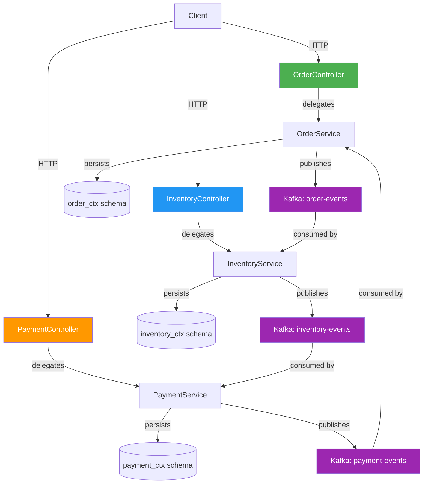
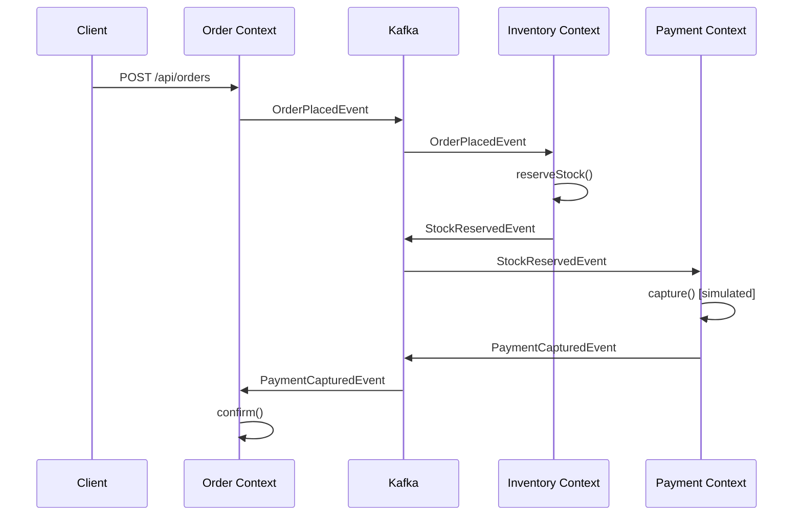

# 01A — Domain-Driven Decomposition Pattern

## Overview
This module demonstrates how to **decompose a monolith using Domain-Driven Design (DDD)** principles. An **E-Commerce Marketplace** is modeled as three isolated bounded contexts — **Order**, **Inventory**, and **Payment** — each with its own database schema and Kafka-based event communication.

---

## Architecture



### Event Flow (Happy Path)



---

## DDD Concepts Implemented

| Concept | Implementation |
|---|---|
| **Bounded Context** | 3 isolated packages: `order`, `inventory`, `payment` — zero cross-imports |
| **Aggregate Root** | `Order`, `InventoryItem`, `Payment` |
| **Entity** | `OrderLineItem` (owned by Order aggregate), `StockReservation` |
| **Value Object** | `Money`, `ShippingAddress`, `PaymentMethod`, `OrderStatus`, `PaymentStatus` |
| **Domain Event** | `OrderPlacedEvent`, `StockReservedEvent`, `PaymentCapturedEvent`, etc. |
| **Factory Method** | `Order.create(...)`, `InventoryItem.create(...)`, `Payment.initiate(...)` |
| **Repository** | One per aggregate root — scoped to bounded context |
| **Application Service** | `OrderService`, `InventoryService`, `PaymentService` |
| **Shared Kernel** | Minimal: `DomainEvent` marker interface + `Money` value object |
| **Ubiquitous Language** | Class/method names match business vocabulary |

---

## Prerequisites

- Java 19+
- Maven 3.8+
- Docker Desktop

---

## Running

### 1. Start Infrastructure

```bash
cd 01-decomposition/01a-domain-driven-decomposition
docker-compose up -d
```

This starts:
| Service | Port | Purpose |
|---|---|---|
| PostgreSQL | 5433 | Database with 3 schemas |
| Kafka | 9093 | Event messaging |
| Kafka UI | 9094 | Topic browser |

### 2. Build & Run

```bash
mvn clean compile
mvn spring-boot:run
```

### 3. Open Swagger UI

```
http://localhost:8101/swagger-ui.html
```

---

## API Endpoints

### Order Context

| Method | URL | Description |
|---|---|---|
| `POST` | `/api/orders` | Place a new order (triggers full event chain) |
| `GET` | `/api/orders` | List all orders |
| `GET` | `/api/orders/{id}` | Get specific order |
| `PUT` | `/api/orders/{id}/cancel` | Cancel an order (triggers stock release) |

### Inventory Context

| Method | URL | Description |
|---|---|---|
| `POST` | `/api/inventory` | Add/replenish inventory stock |
| `GET` | `/api/inventory` | List all inventory items |
| `GET` | `/api/inventory/{sku}` | Get inventory by SKU |

### Payment Context

| Method | URL | Description |
|---|---|---|
| `GET` | `/api/payments` | List all payments |
| `GET` | `/api/payments/{id}` | Get payment by ID |
| `GET` | `/api/payments/order/{orderId}` | Get payments for an order |

---

## Testing the Full Flow

```bash
# 1. Seed inventory
curl -X POST http://localhost:8101/api/inventory \
  -H "Content-Type: application/json" \
  -d '{"sku": "LAPTOP-001", "productName": "MacBook Pro 14", "quantity": 50}'

curl -X POST http://localhost:8101/api/inventory \
  -H "Content-Type: application/json" \
  -d '{"sku": "MOUSE-001", "productName": "Logitech MX Master 3S", "quantity": 100}'

# 2. Place an order (triggers: OrderPlaced → StockReserved → PaymentCaptured → OrderConfirmed)
curl -X POST http://localhost:8101/api/orders \
  -H "Content-Type: application/json" \
  -d '{
    "customerId": "CUST-42",
    "items": [
      {"productId": "LAPTOP-001", "productName": "MacBook Pro 14", "quantity": 1, "unitPrice": 199900},
      {"productId": "MOUSE-001", "productName": "Logitech MX Master 3S", "quantity": 2, "unitPrice": 8999}
    ],
    "shippingAddress": {
      "street": "123 MG Road",
      "city": "Bangalore",
      "state": "Karnataka",
      "zipCode": "560001",
      "country": "IN"
    }
  }'

# 3. Check order status (should be CONFIRMED after ~1 second)
curl http://localhost:8101/api/orders

# 4. Check inventory (stock should be reduced)
curl http://localhost:8101/api/inventory/LAPTOP-001

# 5. Check payment
curl http://localhost:8101/api/payments
```

---

## ✅ Pros

- **Strong encapsulation**: Each bounded context owns its schema — no cross-context data access
- **Business alignment**: Code vocabulary matches business vocabulary (ubiquitous language)
- **Loose coupling**: Cross-context communication via Kafka events, not direct method calls
- **Compensating transactions**: Inventory releases stock if payment fails
- **Testability**: Domain logic is pure Java — easy to unit test without Spring context
- **Scalability**: Each context can evolve independently

## ❌ Cons

- **Upfront complexity**: Requires deep domain modeling knowledge and time
- **Event schema evolution**: Changing event contracts requires coordination
- **Eventual consistency**: Order confirmation is asynchronous — not immediate
- **Learning curve**: Aggregates, value objects, bounded contexts require practice
- **Over-engineering risk**: Not suitable for simple CRUD-heavy domains

---

## When to Use

✅ Complex business domains with rich behavior (e-commerce, banking, insurance)
✅ Large teams working on different subdomains
✅ When the business model changes frequently
❌ Simple CRUD services
❌ Small teams or early-stage startups

---

## ⚠️ Gotchas & Lessons Learned

### `@PathVariable` / `@RequestParam` — Explicit Names Required (Spring Boot 3.2+)

With **Spring Boot 3.2+** (Spring Framework 6.1+), `@PathVariable` and `@RequestParam` **must** explicitly declare the bound parameter name. The earlier fallback that resolved names via Java reflection has been removed for better security and performance.

```java
// ❌ BROKEN in Spring Boot 3.2+ — silently passes null
@GetMapping("/{sku}")
public InventoryItem getBySku(@PathVariable String sku) { ... }

// ✅ WORKS — explicit parameter name binding
@GetMapping("/{sku}")
public InventoryItem getBySku(@PathVariable("sku") String sku) { ... }
```

**Symptoms**: API returns `500 Internal Server Error` on any endpoint with path variables, while endpoints without path variables (like list-all) work fine. The underlying query receives `null` instead of the actual path value.

**Fix**: Always use explicit names — `@PathVariable("id")`, `@RequestParam("name")` — in all controller methods. Alternatively, add the `-parameters` compiler flag to `javac`, but explicit names are the recommended practice.

---

## Infrastructure Teardown

```bash
docker-compose down -v
```
