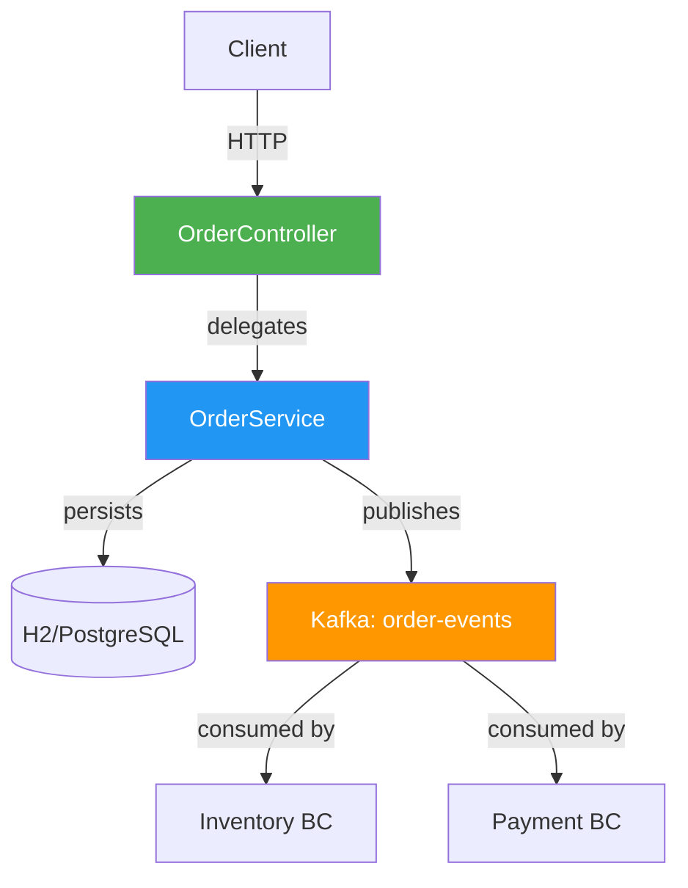

# 01A — Domain-Driven Decomposition Pattern

## Overview
This module demonstrates how to **decompose a monolith using Domain-Driven Design (DDD)** principles. The Order bounded context is implemented as a standalone Spring Boot service with its own database and Kafka event publishing.

---

## Architecture



### Key DDD Concepts Implemented

| Concept | Implementation |
|---|---|
| **Bounded Context** | Order domain is fully isolated — no imports from Inventory or Payment |
| **Aggregate Root** | `Order` class enforces all business invariants |
| **Value Object** | `OrderStatus` enum represents domain state |
| **Domain Event** | `OrderPlacedEvent` record published to Kafka for cross-context communication |
| **Repository** | `OrderRepository` (Spring Data JPA) — infrastructure detail, not domain |
| **Application Service** | `OrderService` — orchestrates domain logic and event publishing |
| **Factory Method** | `Order.create(...)` — controls how Orders come into existence |

---

## Running

```bash
# Start infrastructure
docker-compose up -d kafka

# Run the module
cd 01-decomposition/01a-domain-driven-decomposition
mvn spring-boot:run

# Open Swagger UI
open http://localhost:8101/swagger-ui.html
```

---

## API Endpoints

| Method | URL | Description |
|---|---|---|
| `POST` | `/api/orders` | Place a new order (publishes Kafka event) |
| `GET` | `/api/orders` | List all orders |
| `GET` | `/api/orders/{id}` | Get specific order |
| `PUT` | `/api/orders/{id}/confirm` | Confirm a pending order |
| `PUT` | `/api/orders/{id}/cancel` | Cancel an order |

---

## ✅ Pros

- **Strong encapsulation**: Each bounded context is independently deployable
- **Business alignment**: Code vocabulary matches business vocabulary (ubiquitous language)
- **Scalability**: Each context can be scaled, deployed, and evolved independently
- **Loose coupling**: Cross-context communication via events, not direct method calls
- **Testability**: Domain logic is pure Java — easy to unit test without Spring context

## ❌ Cons

- **Upfront complexity**: Requires deep domain modeling knowledge and time
- **Overhead for simple domains**: CRUD-heavy domains benefit little from DDD
- **Event schema evolution**: Changing event contracts requires coordination between consumers
- **Learning curve**: Aggregates, value objects, bounded contexts require practice to get right
- **Over-engineering risk**: Applying DDD to every microservice is often unnecessary

---

## When to Use

✅ Complex business domains with rich behavior (e-commerce, banking, insurance)  
✅ Large teams working on different subdomains  
✅ When the business model changes frequently  
❌ Simple CRUD services  
❌ Small teams or early-stage startups  
