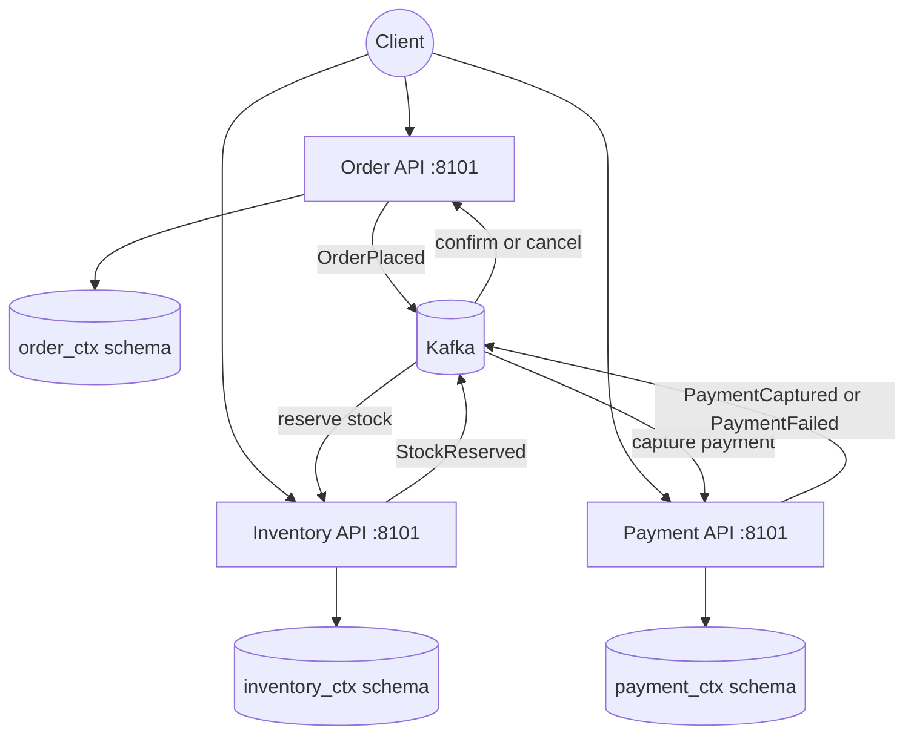
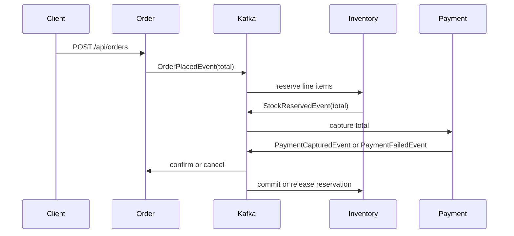

# 01A — Domain-Driven Decomposition

This module demonstrates decomposing an e-commerce monolith into three DDD bounded contexts:

- **Order** owns order lifecycle and shipping information.
- **Inventory** owns stock and reservations.
- **Payment** owns payment lifecycle and payment method details.

For this learning module the contexts run inside one Spring Boot process so the complete flow is easy to start. They are isolated by package boundaries, PostgreSQL schemas, aggregate ownership, and Kafka integration events. In a production decomposition, each context can be extracted into its own deployable service without changing its domain model.

Interview preparation: [`iprep.md`](iprep.md)

## Architecture



## Event flow



## What is implemented

| DDD concept | Implementation |
|---|---|
| Bounded contexts | `order`, `inventory`, and `payment` packages |
| Aggregate roots | `Order`, `InventoryItem`, and `Payment` |
| Entities | `OrderLineItem` and `StockReservation` |
| Value objects | `Money`, `ShippingAddress`, and `PaymentMethod` |
| Integration events | Order, inventory, and payment event records |
| Persistence isolation | `order_ctx`, `inventory_ctx`, and `payment_ctx` PostgreSQL schemas |
| Cross-context communication | Kafka topics; no repository or entity references cross contexts |
| Compensation and commit | Failed stock/payment processing cancels the order and releases reservations; captured payment commits the reservation |

Payment processing is simulated. The success probability is configurable with `ddd.payment.success-rate` and defaults to `0.9`; tests can set it to `1.0` or `0.0` deterministically.

## Start infrastructure

For the complete repository Docker environment, start the shared infrastructure
and this application from the repository root:

```bash
docker compose up -d
docker compose -f docker-compose.yml -f docker-compose.modules.yml \
  --profile apps up -d --build ddd-ecommerce postgres kafka zookeeper
```

| Dependency | Address |
|---|---|
| PostgreSQL | `localhost:5433` |
| Kafka | `localhost:9093` |
| Kafka UI | <http://localhost:9094> |

The module uses the root PostgreSQL and Kafka containers when started through
the application overlay. The `ddd_ecommerce` database is created by the root
PostgreSQL image initialization script.

For the module-local isolated infrastructure, the legacy compose file remains
available under this module directory.

## Configuration

The defaults are defined in [`src/main/resources/application.yml`](src/main/resources/application.yml):

| Setting | Default |
|---|---|
| Application port | `8101` |
| PostgreSQL URL | `jdbc:postgresql://localhost:5433/ddd_ecommerce` |
| Kafka bootstrap server | `localhost:9093` |
| Payment success rate | `0.9` |
| JPA schema management | `update` |

Override the payment simulation rate at runtime when testing compensation behavior:

```bash
mvn spring-boot:run "-Dspring-boot.run.arguments=--ddd.payment.success-rate=1.0"
```

Use `0.0` to force payment failure, or `1.0` to force the successful order path.

## Build

From this module directory:

```bash
mvn clean verify
```

From the repository root:

```bash
mvn -pl 01-decomposition/01a-domain-driven-decomposition clean verify
```

## Run and verify

```bash
mvn spring-boot:run
```

Start the module infrastructure before running the application:

```bash
docker compose up -d
```

To stop the module infrastructure later:

```bash
docker compose down
```

- Swagger UI: <http://localhost:8101/swagger-ui.html>
- OpenAPI JSON: <http://localhost:8101/api-docs>
- Health: <http://localhost:8101/actuator/health>

Run the module tests without infrastructure:

```bash
mvn test
```

## API examples

Seed or replenish inventory:

```bash
curl -X POST http://localhost:8101/api/inventory \
  -H "Content-Type: application/json" \
  -d '{"sku":"LAPTOP-001","productName":"Laptop","quantity":10}'
```

Place an order:

```bash
curl -X POST http://localhost:8101/api/orders \
  -H "Content-Type: application/json" \
  -d '{
    "customerId":"CUST-42",
    "items":[{"productId":"LAPTOP-001","productName":"Laptop","quantity":1,"unitPrice":999.99}],
    "shippingAddress":{"street":"1 MG Road","city":"Bengaluru","state":"Karnataka","zipCode":"560001","country":"IN"}
  }'
```

The order is initially `PENDING`. After Kafka processes the event chain it becomes `CONFIRMED` on payment success or `CANCELLED` on stock/payment failure.

Useful endpoints:

| Method | Endpoint | Purpose |
|---|---|---|
| POST | `/api/orders` | Place an order |
| GET | `/api/orders` | List orders |
| GET | `/api/orders/{orderId}` | Read an order |
| PUT | `/api/orders/{orderId}/cancel` | Cancel and release reservations |
| POST | `/api/inventory` | Add or replenish stock |
| GET | `/api/inventory/{sku}` | Read stock |
| GET | `/api/payments/order/{orderId}` | Read payments for an order |

## Trade-offs

DDD aligns service boundaries with business capabilities, but introduces eventual consistency, event versioning, and compensation logic. The shared database in this module is intentionally limited to separate schemas so the extraction boundary remains visible.
