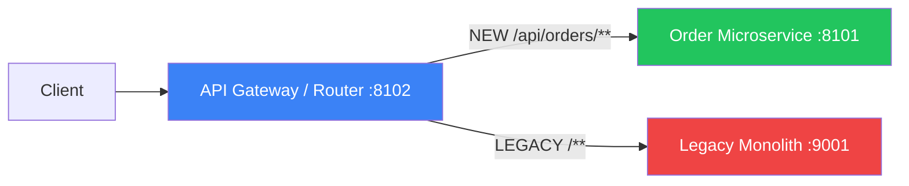

# 01b — Strangler Fig Pattern

## What is it?

The **Strangler Fig** pattern is a migration strategy to incrementally replace a monolith with microservices — route by route, without a "big bang" rewrite.

## Architecture



## Migration Phases

| Phase | What Happens |
|-------|-------------|
| 1. Add router | Gateway intercepts all traffic in front of monolith |
| 2. Extract route | Build `OrderService`, route `/api/orders/**` to it |
| 3. Validate | Run both in parallel; compare responses |
| 4. Strangle | Route more paths from monolith to new services |
| 5. Kill monolith | When 100% traffic migrated, decommission monolith |

## Running the Demo

```bash
# Start the router (acts as a strangler proxy)
cd 01-decomposition/01b-strangler-fig
mvn spring-boot:run

# Observe routing in logs:
# X-Version: green → routes to new Order Service
# Everything else → routes to Monolith
```

## Key Config (`application.yml`)

```yaml
spring.cloud.gateway.routes:
  - id: orders-new
    uri: http://localhost:8101      # New microservice
    predicates: [Path=/api/orders/**]
  - id: monolith-fallback
    uri: http://localhost:9001      # Legacy monolith
    predicates: [Path=/**]          # Catches all remaining paths
```

## ✅ Pros
- No big-bang rewrite
- Team can work iteratively
- Easy rollback (just change routes)
- Each service can use different stack

## ❌ Cons
- Dual-maintenance period increases cost
- Data synchronization complexity grows
- Network hop added for every request

## When to Use
- Migrating a large legacy system where full rewrite is too risky
- Team lacks capacity for simultaneous full rewrite
- Need to release value early during migration
