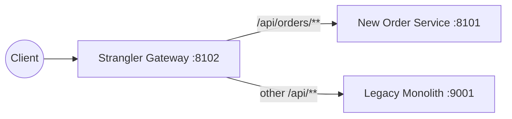
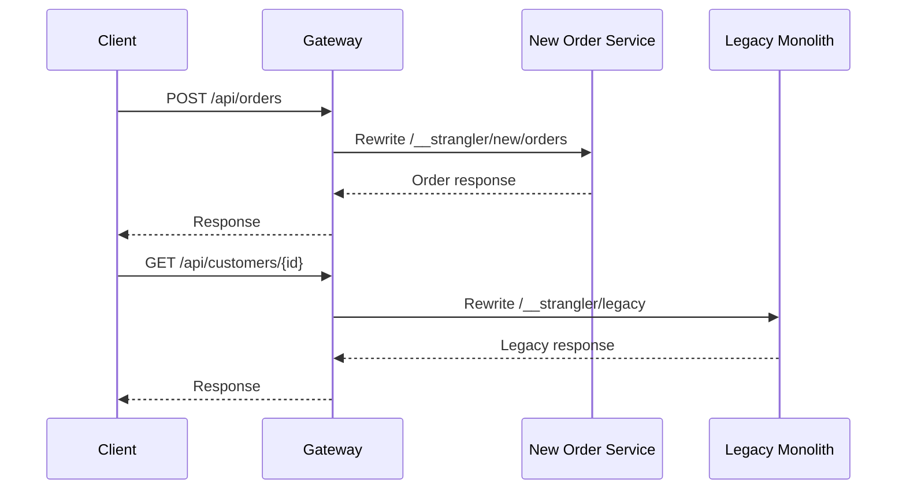
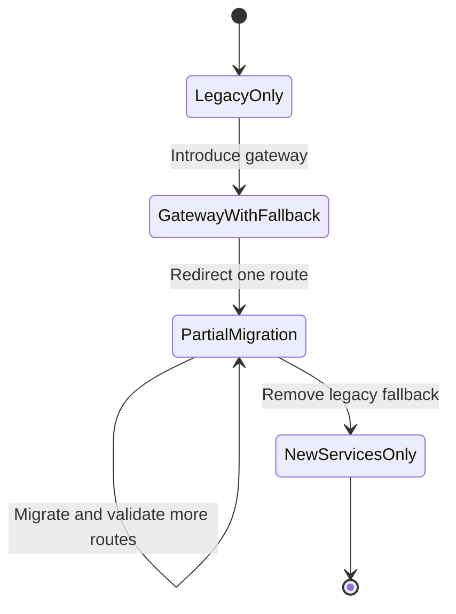

# 01B — Strangler Fig

The Strangler Fig pattern migrates a legacy application incrementally. A gateway is placed in front of the monolith, then individual routes are redirected to replacement services while all remaining traffic continues to use the legacy application.

Interview preparation: [`iprep.md`](iprep.md)

## Routing model



The migrated order route is evaluated first. The fallback route handles the remaining `/api/**` traffic. Management endpoints stay local to the gateway.

## Request routing flow



## Default configuration

By default the gateway forwards to independently running applications:

```yaml
strangler:
  routes:
    new-service-uri: http://localhost:8101
    legacy-service-uri: http://localhost:9001
```

The gateway preserves the public API contract and rewrites the downstream path to `/__strangler/new/**` or `/__strangler/legacy/**`. The downstream applications can translate those internal paths to their own controllers.

## Configuration

The defaults are defined in [`src/main/resources/application.yml`](src/main/resources/application.yml):

| Setting | Default |
|---|---|
| Gateway port | `8102` |
| New service URI | `http://localhost:8101` |
| Legacy monolith URI | `http://localhost:9001` |
| Migrated route | `/api/orders/**` |
| Fallback route | `/api/**` |

Override downstream locations without changing the application:

```bash
mvn spring-boot:run "-Dspring-boot.run.arguments=--strangler.routes.new-service-uri=http://localhost:8201,--strangler.routes.legacy-service-uri=http://localhost:9201"
```

The `demo` profile replaces external downstreams with in-process demo controllers.

## Self-contained demo

The `demo` profile provides small in-process downstreams. This makes the routing behavior executable without starting a separate monolith and replacement service:

```bash
cd 01-decomposition/01b-strangler-fig
mvn spring-boot:run -Dspring-boot.run.profiles=demo
```

```bash
curl -X POST http://localhost:8102/api/orders \
  -H "Content-Type: application/json" \
  -d '{"customerId":"CUST-1"}'

curl http://localhost:8102/api/customers/CUST-1
```

The first response contains `"handledBy":"NEW_SERVICE"`; the second contains `"handledBy":"LEGACY_MONOLITH"`.

## Tests

```bash
mvn test
```

The integration tests run the gateway with the `demo` profile and verify both route branches through `WebTestClient`.

## Build and run

Build and test from this module directory:

```bash
mvn clean verify
```

Run with independently deployed downstream applications:

```bash
mvn spring-boot:run
```

Run the self-contained demo:

```bash
mvn spring-boot:run "-Dspring-boot.run.profiles=demo"
```

## Migration phases

1. Put the gateway in front of the monolith.
2. Extract one capability, such as orders.
3. Route only that capability to the new service.
4. Compare behavior and migrate additional routes.
5. Remove the legacy route after the final capability has moved.



## Trade-offs

The pattern enables incremental delivery and quick rollback, but temporarily requires two systems, route ownership discipline, and potentially duplicated data. The gateway should remain a migration boundary rather than becoming a second monolith.
