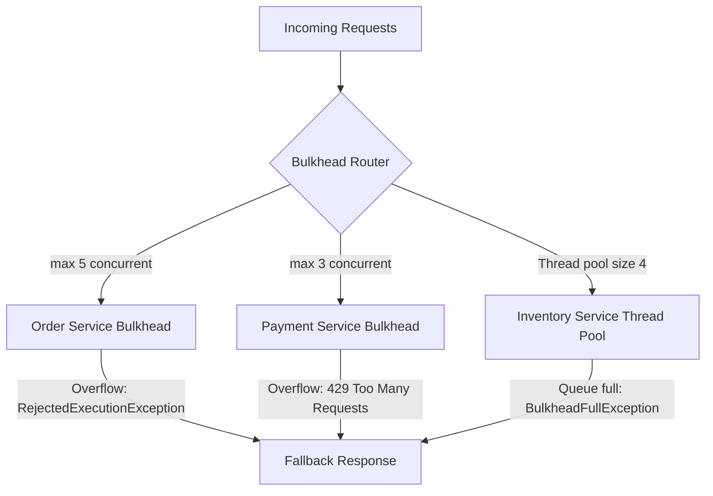

# 01c — Bulkhead Pattern

## What is it?

The **Bulkhead** pattern isolates different parts of a system so that a failure in one component does not cascade to others. Named after ship hull compartments.

## Architecture



## Two Types of Bulkheads

| Type | Implementation | Use Case |
|------|---------------|----------|
| **Semaphore** | `maxConcurrentCalls` | Limits concurrent callers in same thread |
| **Thread Pool** | `coreThreadPoolSize + queue` | Isolates each service in its own thread pool |

## Configuration

```yaml
resilience4j:
  bulkhead:
    instances:
      orderService:
        maxConcurrentCalls: 5       # Only 5 simultaneous calls allowed
        maxWaitDuration: 500ms       # Wait 500ms before rejecting
  thread-pool-bulkhead:
    instances:
      inventoryService:
        maxThreadPoolSize: 4
        coreThreadPoolSize: 2
        queueCapacity: 10
```

## Running the Demo

```bash
cd 01-decomposition/01c-bulkhead
mvn spring-boot:run

# Load test: send 20 concurrent requests
# Watch as excess requests get 503/fallback immediately
```

## ✅ Pros
- Fault isolation prevents cascading failures
- Resources shared fairly between services
- Independent circuit breaking per service

## ❌ Cons
- Thread pool bulkheads consume extra threads
- Tuning concurrency limits is difficult
- Fallbacks must be well-designed to be meaningful

## When to Use
- High traffic services where one slow downstream kills everything
- Shared thread pools need protection from noisy-neighbour services
