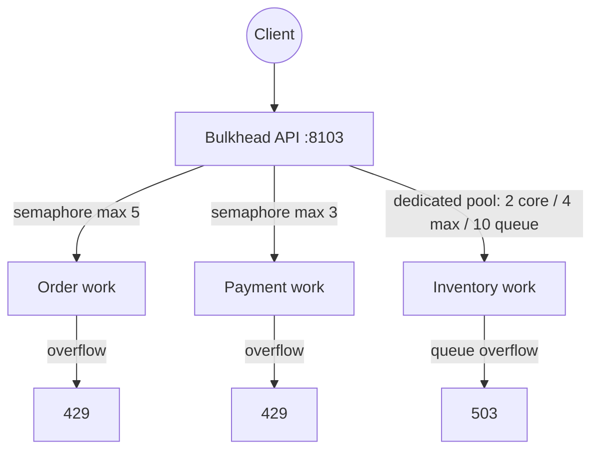
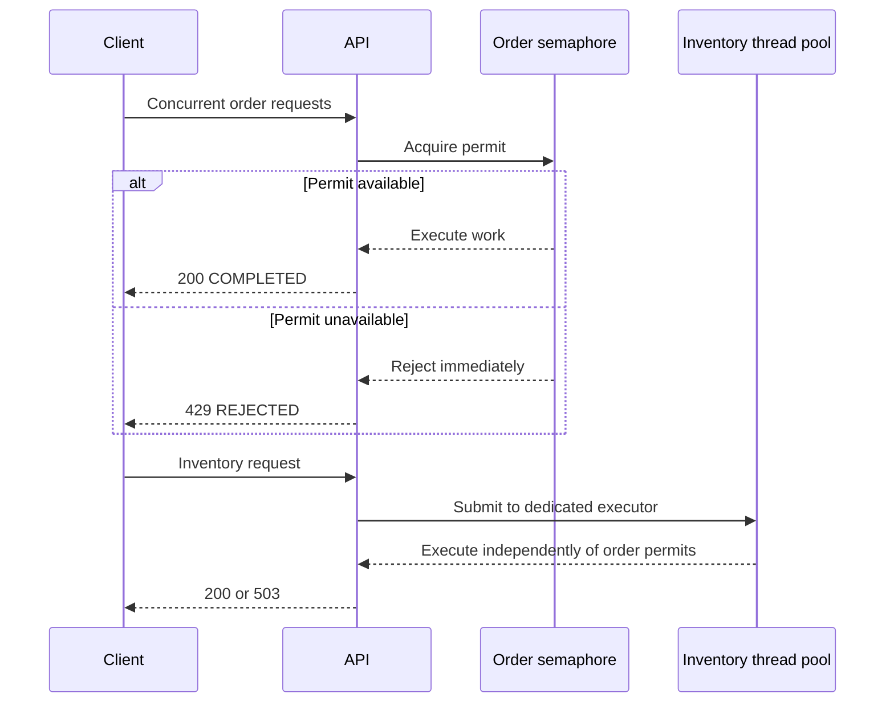
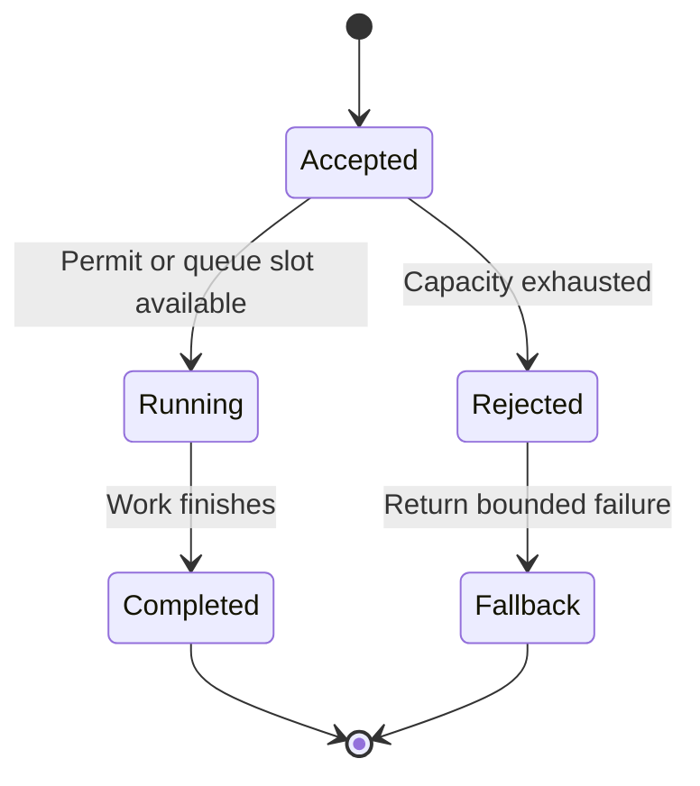

# 01C — Bulkhead

The Bulkhead pattern partitions concurrency so an overloaded or slow operation cannot consume every worker available to the application. This module demonstrates both Resilience4j bulkhead types.

Interview preparation: [`iprep.md`](iprep.md)

## Architecture



## Isolation behavior



## Endpoints

Each endpoint accepts `delayMs` to make contention easy to observe. The value is capped at 30 seconds.

| Method | Endpoint | Bulkhead | Rejection |
|---|---|---|---|
| GET | `/api/bulkheads/orders/{orderId}` | Semaphore, max 5 concurrent calls | HTTP 429 |
| GET | `/api/bulkheads/payments/{paymentId}` | Semaphore, max 3 concurrent calls | HTTP 429 |
| GET | `/api/bulkheads/inventory/{sku}` | Dedicated thread pool, queue capacity 10 | HTTP 503 |

Example:

```bash
curl "http://localhost:8103/api/bulkheads/orders/order-1?delayMs=1000"
curl "http://localhost:8103/api/bulkheads/inventory/SKU-1?delayMs=1000"
```

Successful responses report the worker thread. Inventory work runs on the Resilience4j executor, making the isolation boundary visible in the response and logs. Rejected responses contain `status: REJECTED` and an explanatory message.

## Configuration

The defaults are defined in [`src/main/resources/application.yml`](src/main/resources/application.yml):

| Setting | Default |
|---|---|
| Application port | `8103` |
| Order semaphore | 5 concurrent calls, 500 ms wait |
| Payment semaphore | 3 concurrent calls, 100 ms wait |
| Inventory pool | 2 core / 4 maximum threads |
| Inventory queue | 10 requests |
| Maximum simulated delay | 30 seconds |

Resilience4j limits can be changed in the YAML configuration. Request-level delays are supplied with the `delayMs` query parameter and are validated by the application.

## Build

From this module directory:

```bash
mvn clean verify
```

From the repository root:

```bash
mvn -pl 01-decomposition/01c-bulkhead clean verify
```

## Run and observe

```bash
cd 01-decomposition/01c-bulkhead
mvn spring-boot:run
```

From the repository root, run directly with:

```bash
mvn -pl 01-decomposition/01c-bulkhead spring-boot:run
```

- Swagger UI: <http://localhost:8103/swagger-ui.html>
- Health: <http://localhost:8103/actuator/health>
- Metrics: <http://localhost:8103/actuator/metrics>

Generate concurrent requests with PowerShell:

```powershell
1..12 | ForEach-Object -Parallel {
  Invoke-WebRequest "http://localhost:8103/api/bulkheads/orders/order-$_?delayMs=2000"
}
```

Run the automated tests with:

```bash
mvn test
```

## Trade-offs

Bulkheads protect critical work and provide predictable failure under load, but reduce the amount of concurrency available to each partition. Limits, queue sizes, and fallbacks must be selected from capacity measurements rather than copied blindly between services.


