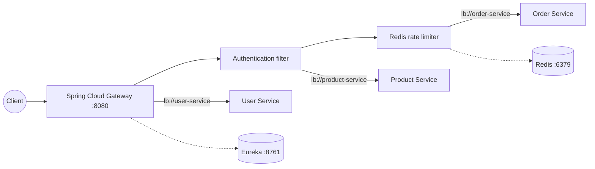
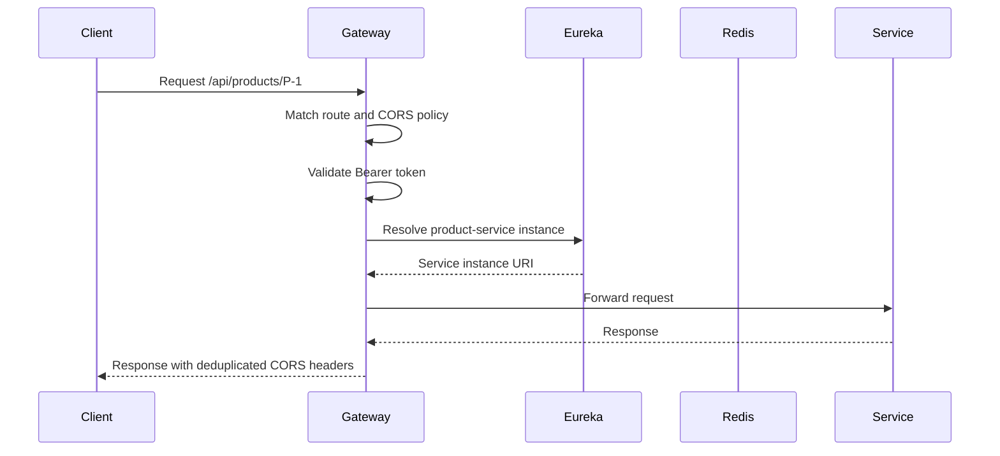

# 02A — API Gateway

This module demonstrates Spring Cloud Gateway as a single entry point for
client traffic. It provides route matching, authentication filtering, Redis
rate limiting, CORS handling, service discovery, and gateway observability.

Interview preparation: [`iprep.md`](iprep.md)

## Architecture



## Request flow



The `demo` profile replaces external service discovery and downstream calls
with in-process controllers. It is intended for local verification only; it
does not simulate a network hop.

## Routes and policies

| Public route | Destination | Policy |
|---|---|---|
| `/api/orders/**` | `lb://order-service` | Authentication + Redis rate limiter |
| `/api/products/**` | `lb://product-service` | Authentication |
| `/api/users/**` | `lb://user-service` | Route forwarding |

The default authentication filter accepts `Authorization: Bearer demo-token`
only as a learning stub. Production authentication should validate JWTs using
issuer, audience, signature, expiry, and scopes.

## Configuration

Defaults are in [`src/main/resources/application.yml`](src/main/resources/application.yml):

| Setting | Default |
|---|---|
| Gateway port | `8080` |
| Eureka URL | `http://localhost:8761/eureka/` |
| Redis | `localhost:6379` |
| Order rate limit | 10 tokens/second, burst 20 |
| Demo token | `demo-token` |

## Build and run
mvn test -pl 02-communication/02a-api-gateway

From this module directory:

```bash
mvn clean verify
```

From the repository root:

```bash
mvn -pl 02-communication/02a-api-gateway clean verify
```

Run with Eureka, Redis, and downstream services:

```bash
mvn spring-boot:run
```

Run the self-contained local demo:

```bash
mvn spring-boot:run "-Dspring-boot.run.profiles=demo"
```

Demo requests:

```bash
curl http://localhost:8080/api/users/U-1
curl -i http://localhost:8080/api/products/P-1
curl -H "Authorization: Bearer demo-token" http://localhost:8080/api/products/P-1
```

Useful endpoints:

- Health: <http://localhost:8080/actuator/health>
- Gateway routes: <http://localhost:8080/actuator/gateway/routes>
- Metrics: <http://localhost:8080/actuator/metrics>

## Trade-offs

An API gateway centralizes cross-cutting concerns and hides service topology,
but it becomes a critical shared dependency. Keep it stateless and thin, scale
it horizontally, set downstream timeouts, and avoid putting domain workflows in
the gateway.
