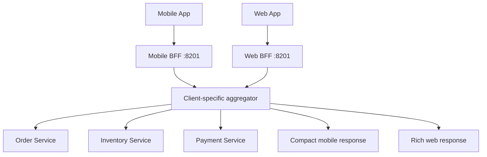
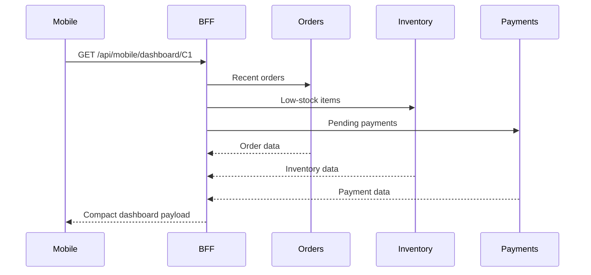

# 02B — Backend for Frontend (BFF)

The BFF pattern creates a backend tailored to a particular client experience.
This module exposes mobile and web dashboard contracts from one Spring Boot
process for learning; in production they can be deployed as separate BFFs.

Interview preparation: [`iprep.md`](iprep.md)

## Architecture



## Aggregation flow



## Client contracts

| Client | Endpoint | Response strategy |
|---|---|---|
| Mobile | `/api/mobile/dashboard/{userId}` | Last three orders, pending payments, SKU-only low-stock list |
| Web | `/api/web/dashboard/{userId}` | Full user, order, inventory, payment, and total-value data |

The BFF owns representation shaping, not the underlying business truth. The
`BffDataGateway` interface separates aggregation from downstream transport. The
`demo` profile uses deterministic in-memory data; the default profile uses the
HTTP adapter and configurable downstream URLs.

## Configuration

Defaults are in [`src/main/resources/application.yml`](src/main/resources/application.yml):

| Setting | Default |
|---|---|
| Application port | `8201` |
| Order service URL | `http://localhost:8101` |
| Inventory service URL | `http://localhost:8301` |
| Payment service URL | `http://localhost:8401` |
| Eureka URL | `http://localhost:8761/eureka/` |

## Build and run
mvn test -pl 02-communication/02b-backend-for-frontend

From this module directory:

```bash
mvn clean verify
```

From the repository root:

```bash
mvn -pl 02-communication/02b-backend-for-frontend clean verify
```

Run against configured downstream services:

```bash
mvn spring-boot:run
```

Run the self-contained deterministic demo:

```bash
mvn spring-boot:run "-Dspring-boot.run.profiles=demo"
```

Demo requests:

```bash
curl http://localhost:8201/api/mobile/dashboard/C1
curl http://localhost:8201/api/web/dashboard/C1
```

Useful endpoints:

- Swagger UI: <http://localhost:8201/swagger-ui.html>
- Health: <http://localhost:8201/actuator/health>
- Metrics: <http://localhost:8201/actuator/metrics>

## Trade-offs

A BFF reduces over-fetching and lets each client evolve independently, but it
adds services, duplicated orchestration, and another latency boundary. Keep BFFs
focused on client needs, enforce deadlines for downstream calls, and avoid
turning one BFF into a shared domain service.
