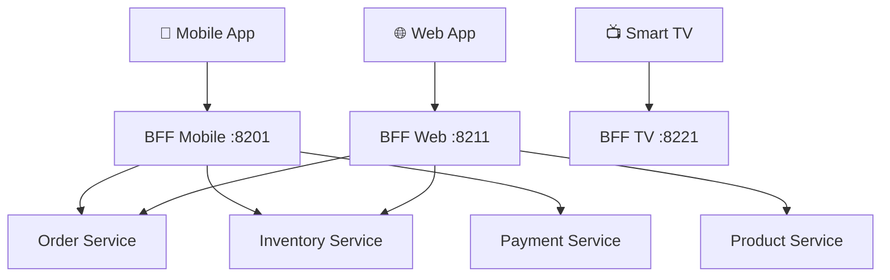

# 02b — Backend for Frontend (BFF)

## What is it?

The **BFF** pattern creates a dedicated backend for each frontend client type (mobile, web, smart TV). Each BFF aggregates and shapes data specifically for its client's needs.

## Architecture



## Why Different BFFs?

| Client | Needs | BFF Optimization |
|--------|-------|-----------------|
| Mobile | Small payload, battery optimization | Aggregates 5 calls into 1, strips unused fields |
| Web | Rich data, real-time updates | Full payload, Server-Sent Events |
| Smart TV | Simple navigation, large images | Pre-computed suggestions, image URLs only |

## Key Implementation Pattern

```java
// Mobile BFF aggregates 3 downstream calls into 1
@GetMapping("/dashboard")
public Mono<MobileDashboard> getMobileDashboard(@RequestHeader("userId") String userId) {
    return Mono.zip(
        orderClient.getRecentOrders(userId, 3),     // Last 3 orders only
        inventoryClient.getLowStockItems(),          // Relevant inventory
        paymentClient.getPendingPayments(userId)    // Pending payments
    ).map(tuple -> MobileDashboard.from(tuple.getT1(), tuple.getT2(), tuple.getT3()));
}
```

## Running the Demo

```bash
cd 02-communication/02b-backend-for-frontend
mvn spring-boot:run

# Swagger: http://localhost:8201/swagger-ui.html
```

## ✅ Pros
- Each client gets exactly the data it needs (no over/under-fetching)
- Teams can evolve their BFF independently
- Well-suited for GraphQL

## ❌ Cons
- Code duplication across BFFs
- More services to deploy and maintain
- Risk of BFF becoming a God Service

## When to Use
- Multiple client types with very different data needs
- Mobile clients with bandwidth/battery constraints
