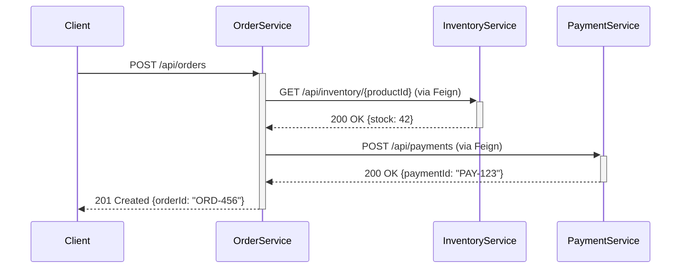

# 02c — Synchronous REST with OpenFeign

## What is it?

Demonstrates inter-service HTTP communication using **Spring Cloud OpenFeign** — a declarative REST client that eliminates boilerplate and integrates with Eureka load balancing.

## Architecture



## Feign Client Example

```java
// One annotation = full REST client with Eureka load balancing
@FeignClient(name = "inventory-service", fallbackFactory = InventoryFallback.class)
public interface InventoryClient {

    @GetMapping("/api/inventory/{productId}")
    StockResponse checkStock(@PathVariable("productId") String productId);

    @PutMapping("/api/inventory/{productId}/reserve")
    void reserveStock(@PathVariable("productId") String productId,
                      @RequestParam int quantity);
}
```

## Feign vs RestTemplate vs WebClient

| Feature | OpenFeign | RestTemplate | WebClient |
|---------|-----------|-------------|-----------|
| Style | Declarative | Imperative | Reactive |
| Load balancing | ✅ Automatic | Manual | Manual |
| Fallbacks | ✅ Native | ❌ Manual | ❌ Manual |
| Reactive | ❌ | ❌ | ✅ |
| Boilerplate | Minimal | High | Medium |

## Running the Demo

```bash
# Start Eureka first
cd 05-discovery-config/05a-service-registry
mvn spring-boot:run

# Then start sync-rest
cd 02-communication/02c-synchronous-rest
mvn spring-boot:run

# Swagger: http://localhost:8202/swagger-ui.html
```

## ✅ Pros
- Declarative, minimal boilerplate
- Built-in Eureka load balancing
- Easy fallback/circuit breaker integration

## ❌ Cons
- Tight temporal coupling (both services must be up)
- Cascading failure risk without circuit breaker
- Performance limited by slowest downstream call

## When to Use
- Simple request/response patterns
- Both services expected to be always up
- Latency is acceptable (< 200ms)
