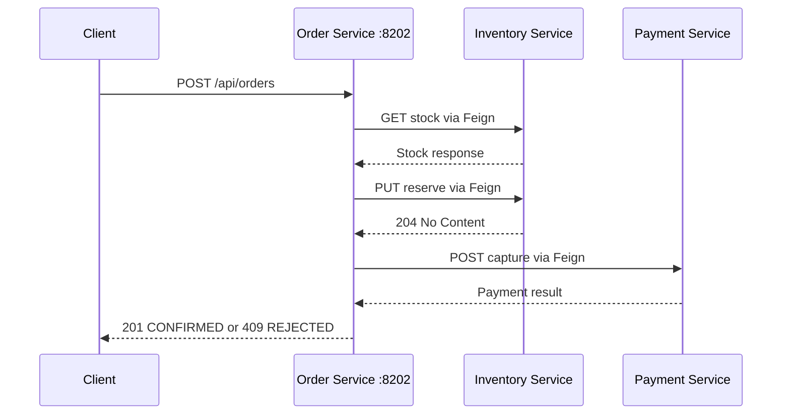
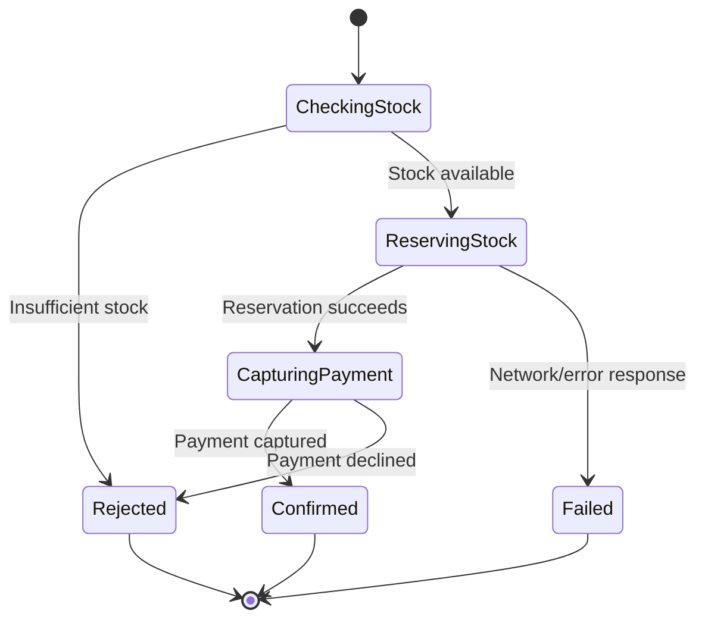

# 02C — Synchronous REST with OpenFeign

This module demonstrates synchronous service-to-service communication with
Spring Cloud OpenFeign. The order workflow checks inventory, reserves stock,
and captures payment before returning a final response to the caller.

Interview preparation: [`iprep.md`](iprep.md)

## Architecture



## Synchronous failure boundary



The synchronous chain is intentionally simple for learning. In production,
reservation and payment usually need compensation, idempotency, timeouts,
circuit breakers, and often a saga rather than one blocking request chain.

## API

```http
POST /api/orders
Content-Type: application/json

{
  "productId": "P-1",
  "quantity": 2,
  "unitPrice": 49.99
}
```

Successful orders return `201 Created`; insufficient stock or declined payment
returns `409 Conflict` with a rejection reason.

## Configuration

Defaults are in [`src/main/resources/application.yml`](src/main/resources/application.yml):

| Setting | Default |
|---|---|
| Application port | `8202` |
| Inventory service URL | `http://localhost:8301` |
| Payment service URL | `http://localhost:8401` |
| Feign connect timeout | 2 seconds |
| Feign read timeout | 5 seconds |
| Eureka URL | `http://localhost:8761/eureka/` |

The `demo` profile points both Feign clients to this application on port 8202,
where deterministic downstream controllers simulate inventory and payment.

## Build and run
mvn test -pl 02-communication/02c-synchronous-rest

From this module directory:

```bash
mvn clean verify
```

From the repository root:

```bash
mvn -pl 02-communication/02c-synchronous-rest clean verify
```

Run against independently deployed services:

```bash
mvn spring-boot:run
```

Run the self-contained demo:

```bash
mvn spring-boot:run "-Dspring-boot.run.profiles=demo"
```

Demo request:

```bash
curl -X POST http://localhost:8202/api/orders \
  -H "Content-Type: application/json" \
  -d '{"productId":"P-1","quantity":2,"unitPrice":49.99}'
```

Useful endpoints:

- Swagger UI: <http://localhost:8202/swagger-ui.html>
- Health: <http://localhost:8202/actuator/health>
- H2 console: <http://localhost:8202/h2-console>

## Trade-offs

Feign is concise and readable, but synchronous calls create temporal coupling and
latency accumulation. Every downstream call should have a deadline and explicit
failure policy. Use asynchronous messaging or a saga when the business workflow
does not need an immediate final answer.
