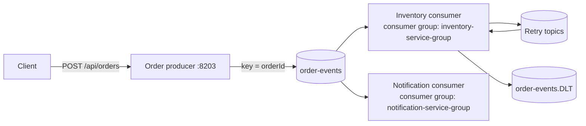
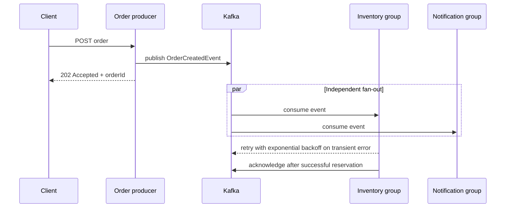

# 02D — Asynchronous Messaging with Kafka

This module demonstrates event-driven communication with Kafka. The producer returns
`202 Accepted` after publishing an `OrderCreatedEvent`; inventory and notification
consumers process the event independently in separate consumer groups.

## Architecture





## Patterns demonstrated

| Pattern | Implementation | Why it matters |
|---|---|---|
| Producer reliability | `enable.idempotence=true`, `acks=all` | Reduces duplicate/lost publishes |
| Publish/subscribe fan-out | Separate consumer groups | Each subscriber receives every order |
| Retry and DLT | `@RetryableTopic`, `order-events.DLT` | Isolates transient failures and poison messages |
| Consumer idempotency | `ProcessedOrderStore` | Duplicate deliveries do not reserve twice |
| Partition ordering | Kafka key is `orderId` | Events for one order remain in one partition |

## Configuration

| Property | Default | Purpose |
|---|---|---|
| `server.port` | `8203` | HTTP endpoint for order submission |
| `spring.kafka.bootstrap-servers` | `localhost:9092` | Kafka broker address |
| `kafka.topics.order-created` | `order-events` | Input topic for both consumers |
| `spring.kafka.consumer.auto-offset-reset` | `earliest` | Read existing events for a new group |
| `spring.kafka.listener.ack-mode` | `MANUAL_IMMEDIATE` | Consumer controls successful acknowledgement |

The application creates the configured topics at startup when the broker permits topic
administration. The in-memory idempotency store is intentionally a teaching substitute;
production consumers should use a durable store with a unique `(consumer, eventId)` key.

## Build and run
mvn test -pl 02-communication/02d-async-messaging

From the repository root:

```bash
docker compose up -d zookeeper kafka kafka-ui
mvn -pl 02-communication/02d-async-messaging clean verify
```

Start the service:

```bash
mvn -pl 02-communication/02d-async-messaging spring-boot:run
```

Publish an order:

```bash
curl -X POST http://localhost:8203/api/orders \
  -H "Content-Type: application/json" \
  -d '{"customerId":"C1","productId":"P1","quantity":2,"unitPrice":49.99}'
```

Use `productId: "RETRY"` to deterministically demonstrate retry-topic behavior.
Kafka UI is available at `http://localhost:9093`.

## Trade-offs

Asynchronous messaging provides temporal decoupling, independent scaling, and natural
fan-out. The cost is eventual consistency, more operational infrastructure, harder
debugging, and the need for explicit idempotency and event evolution policies.

## Interview preparation

See [iprep.md](iprep.md) for the architecture explanation, tricky Kafka questions,
failure analysis, and production hardening checklist.
