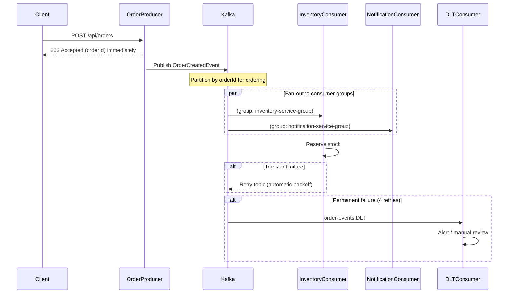

# 02d — Async Messaging with Kafka

## What is it?

Demonstrates **event-driven asynchronous communication** with Kafka: non-blocking producers, consumer groups, @RetryableTopic (non-blocking retry), and Dead Letter Topics (DLT) for poison pill handling.

## Architecture



## Key Kafka Patterns Demonstrated

| Pattern | Where | Details |
|---------|-------|---------|
| Idempotent producer | `OrderProducerController` | `enable.idempotence=true, acks=all` |
| Fan-out | `InventoryConsumer` + `NotificationConsumer` | Different consumer groups receive same events |
| Non-blocking retry | `@RetryableTopic` | Backs off to retry topic without blocking main topic |
| Dead Letter Topic | `order-events.DLT` | Messages moved here after all retries fail |
| Manual ack | `InventoryConsumer` | Only acks after successful processing |

## Running the Demo

```bash
# Start Kafka (via Docker Compose)
docker-compose up -d kafka zookeeper

# Start the service
cd 02-communication/02d-async-messaging
mvn spring-boot:run

# Place an order (triggers Kafka events)
curl -X POST http://localhost:8203/api/orders \
  -H "Content-Type: application/json" \
  -d '{"customerId":"C1","productId":"P1","quantity":2,"unitPrice":49.99}'

# Watch logs — you'll see both consumers process the event
# ~20% chance triggers retry behavior
```

## ✅ Pros
- Temporal decoupling (producer/consumer don't need to be up simultaneously)
- Fan-out to multiple consumers without producer changes
- Non-blocking retry doesn't block message processing
- DLT prevents poison pills from stopping the pipeline

## ❌ Cons
- Eventual consistency — UI can't immediately show result
- Kafka infrastructure complexity
- Idempotency required in consumers to handle retries

## When to Use
- High throughput events (thousands/second)
- Multiple subscribers need the same event
- Processing time varies and blocking is unacceptable
