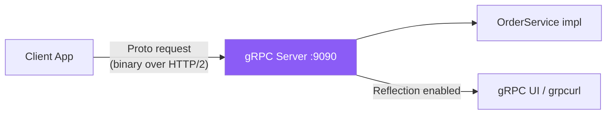

# 02e — gRPC Service

## What is it?

**gRPC** is a high-performance RPC framework using HTTP/2 and Protocol Buffers (Protobuf). Ideal for internal microservice communication where performance matters.

## Architecture



## Proto Definition

```protobuf
// src/main/proto/order.proto
syntax = "proto3";
package com.micarch.grpc;

service OrderService {
  rpc PlaceOrder (PlaceOrderRequest) returns (PlaceOrderResponse);
  rpc GetOrder   (GetOrderRequest)   returns (OrderResponse);
  rpc ListOrders (ListOrdersRequest) returns (stream OrderResponse); // Server streaming
}

message PlaceOrderRequest {
  string customer_id = 1;
  string product_id  = 2;
  int32  quantity    = 3;
  double unit_price  = 4;
}

message PlaceOrderResponse {
  string order_id = 1;
  string status   = 2;
}
```

## gRPC vs REST Comparison

| Feature | gRPC | REST (JSON) |
|---------|------|-------------|
| Protocol | HTTP/2 | HTTP/1.1 |
| Serialization | Protobuf (binary) | JSON (text) |
| Speed | ~7x faster | Baseline |
| Streaming | Bidirectional | SSE / WebSockets only |
| Contract | Strict .proto | OpenAPI (optional) |
| Browser support | ❌ (needs grpc-web) | ✅ Native |

## Running the Demo

```bash
# gRPC server starts on port 9090, REST actuator on 8204
cd 02-communication/02e-grpc-service
mvn spring-boot:run

# Test with grpcurl (needs grpc-tools)
grpcurl -plaintext localhost:9090 list
grpcurl -plaintext -d '{"customer_id":"C1","product_id":"P1","quantity":2,"unit_price":49.99}' \
    localhost:9090 com.micarch.grpc.OrderService/PlaceOrder
```

## ✅ Pros
- 5-7x faster than JSON over HTTP/1.1
- Strong type safety via Protobuf contracts
- Bidirectional streaming for real-time data
- Code generation reduces boilerplate

## ❌ Cons
- Not human-readable (binary)
- Browser clients need grpc-web proxy
- Versioning contract changes is delicate

## When to Use
- Internal service-to-service communication
- High throughput low-latency requirements (ML, IoT, trading)
- Need streaming (e.g., live dashboards, log tailing)
