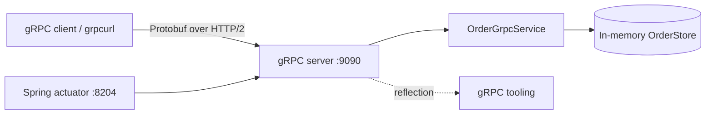
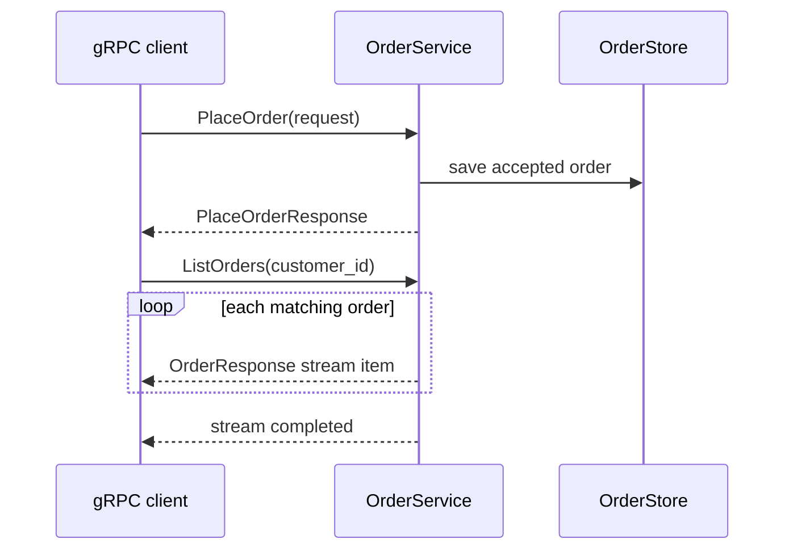

# 02E — gRPC Service Communication

This module demonstrates internal service-to-service communication with gRPC, HTTP/2,
and Protocol Buffers. The service implements unary `PlaceOrder` and `GetOrder` calls
plus server-streaming `ListOrders`.

## Architecture





## Contract

The source contract is [`src/main/proto/order.proto`](src/main/proto/order.proto).
Maven generates Java message and service classes during `generate-sources`.

| RPC | Type | Purpose |
|---|---|---|
| `PlaceOrder` | Unary | Validates and accepts an order |
| `GetOrder` | Unary | Reads one order by ID; returns `NOT_FOUND` when absent |
| `ListOrders` | Server streaming | Streams orders for a customer, or all orders when the filter is blank |

## Configuration

| Property | Default | Purpose |
|---|---|---|
| `server.port` | `8204` | Spring HTTP actuator/OpenAPI port |
| `grpc.server.port` | `9090` | gRPC HTTP/2 port |
| `grpc.server.enable-reflection` | `true` | Enables grpcurl discovery |

The order store is intentionally in memory for the communication example. A production
service would use a database/repository and enforce authorization, deadlines, retries,
structured error details, and mTLS at the platform or gRPC layer.

## Build and run
mvn test -pl 02-communication/02e-grpc-service

From the repository root:

```bash
mvn -pl 02-communication/02e-grpc-service clean verify
mvn -pl 02-communication/02e-grpc-service spring-boot:run
```

The first build downloads the platform-specific `protoc` compiler and generates the
Java classes from `order.proto`.

With `grpcurl` installed:

```bash
grpcurl -plaintext localhost:9090 list
grpcurl -plaintext localhost:9090 describe com.micarch.grpc.OrderService
grpcurl -plaintext -d '{"customer_id":"C1","product_id":"P1","quantity":2,"unit_price":49.99}' \
  localhost:9090 com.micarch.grpc.OrderService/PlaceOrder
grpcurl -plaintext -d '{"customer_id":"C1"}' \
  localhost:9090 com.micarch.grpc.OrderService/ListOrders
```

Health is available at `http://localhost:8204/actuator/health`.

## gRPC versus REST

| Concern | gRPC | REST/JSON |
|---|---|---|
| Transport | HTTP/2 | Commonly HTTP/1.1 |
| Encoding | Compact Protobuf | Human-readable JSON |
| Contract | Required `.proto` schema | OpenAPI is usually optional |
| Streaming | Unary, server, client, and bidirectional | Requires separate streaming technology |
| Browser support | Usually grpc-web/proxy | Native |

## Trade-offs

gRPC gives strong contracts, efficient serialization, multiplexed HTTP/2 transport, and
first-class streaming. It is less convenient for browsers and manual debugging, and
schema evolution, deadlines, status mapping, and observability must be designed carefully.

## Interview preparation

See [iprep.md](iprep.md) for gRPC design questions, tricky HTTP/2 and Protobuf details,
failure handling, and a production checklist.
