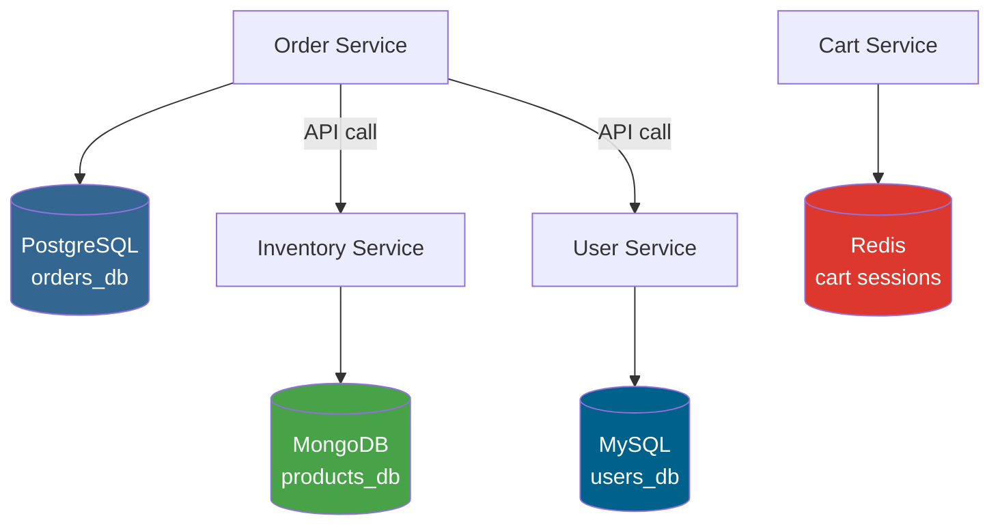

# 03a — Database per Service

## What is it?

Each microservice owns its own database, and **no other service can access it directly**. Cross-service data access must happen through APIs.

## Architecture



## Database Choice by Context

| Service | DB | Why |
|---------|----|-----|
| Orders | PostgreSQL | ACID transactions, relational data |
| Products/Catalog | MongoDB | Flexible schema, nested attributes |
| Shopping Cart | Redis | Sub-millisecond, TTL auto-expiry |
| Users | MySQL | Relational, joins with roles |

## Running the Demo

```bash
# Start infrastructure
docker-compose up -d postgres mongo redis

# Start the service (connects to all 3!)
cd 03-data-management/03a-database-per-service
mvn spring-boot:run

# Swagger: http://localhost:8301/swagger-ui.html
```

## ✅ Pros
- Each service uses the best database for its needs
- Independent scaling of databases
- Schema changes don't affect other services
- Loose coupling — no shared table dependencies

## ❌ Cons
- Cross-cutting queries require API aggregation
- No ACID transactions across services (use Saga)
- Data duplication is sometimes necessary
- More databases to manage and monitor

## When to Use
- Microservices in production with independent scaling
- Different access patterns per service (OLTP vs OLAP)
- Teams have full ownership of their service + database
