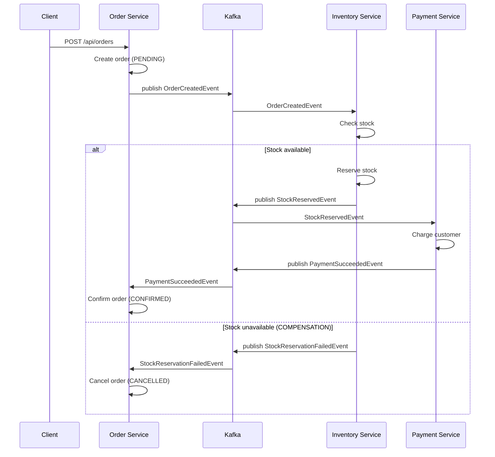

# 03B — Saga Pattern: Choreography

## Overview
Demonstrates the **Saga Choreography** pattern for distributed transactions across microservices using **Kafka domain events**. Each service participant reacts to events and publishes its own events — there is **no central coordinator**.

---

## Architecture



### Kafka Topics Used

| Topic | Published By | Consumed By |
|---|---|---|
| `order-events` | Order Service | Inventory Service |
| `stock-events` | Inventory Service | Payment Service |
| `stock-failed-events` | Inventory Service | Order Service |
| `payment-events` | Payment Service | Order Service |
| `payment-failed-events` | Payment Service | Order Service |

---

## Running

```bash
# Start Kafka
docker-compose up -d kafka zookeeper

# Run the combined demo service
cd 03-data-management/03b-saga-choreography
mvn spring-boot:run

# Place an order
curl -X POST http://localhost:8302/api/orders \
  -H "Content-Type: application/json" \
  -d '{"customerId":"C-1","productId":"PROD-001","quantity":2,"unitPrice":50.0}'

# Watch saga events in Kafka UI
open http://localhost:8090
```

---

## ✅ Pros

- **Loose coupling**: Services only know about events, not about each other
- **No single point of failure**: No orchestrator service to go down
- **Easy to add participants**: A new service just subscribes to the relevant event
- **Naturally async**: Fits event-driven architecture patterns

## ❌ Cons

- **Hard to trace**: Flow is implicit — requires distributed tracing (Zipkin) to follow a saga
- **Cyclic dependencies risk**: Services can end up in circular event loops if not designed carefully
- **Compensation complexity**: Each step must define its own compensating event handler
- **Testing difficulty**: Unit testing choreography requires mocking multiple Kafka topics

---

## When to Use

✅ Highly decoupled microservices with event-driven architecture  
✅ Long-running business processes (order fulfillment, trip booking)  
✅ When adding new participants should not require changes to existing services  
❌ When you need explicit visibility into the saga state (use Orchestration instead)  
❌ Fewer than 3 steps (overhead not justified)  
