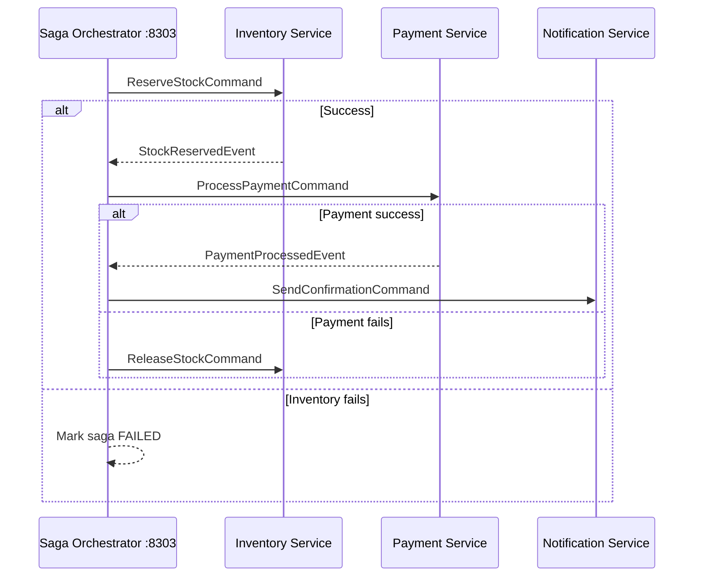

# 03c — Saga Orchestration

## What is it?

**Saga Orchestration** uses a central **Saga Orchestrator** that explicitly commands each participant service step-by-step. The orchestrator knows the entire workflow and handles compensation.

## Architecture



## Orchestration vs Choreography

| Aspect | Orchestration | Choreography |
|--------|--------------|-------------|
| Coordination | Central orchestrator | Each service reacts to events |
| Visibility | High — full saga state | Low — distributed |
| Coupling | Loose (command/event) | Very loose |
| Complexity | Orchestrator is complex | Each service is complex |
| Debugging | Easy — one place | Hard — trace across services |

## Running the Demo

```bash
docker-compose up -d kafka postgres
cd 03-data-management/03c-saga-orchestration
mvn spring-boot:run

# Swagger: http://localhost:8303/swagger-ui.html
# H2 Console (saga state): http://localhost:8303/h2-console
```

## ✅ Pros
- Easy to visualize the entire workflow
- Centralized compensation logic
- Easy to add audit trail and monitoring

## ❌ Cons
- Orchestrator becomes critical single point of failure
- Risk of becoming a distributed monolith
- New services must be registered with orchestrator

## When to Use
- Complex multi-step workflows where visibility matters
- Need to audit every step of a transaction
- Team with less Kafka expertise (choreography is harder to debug)
