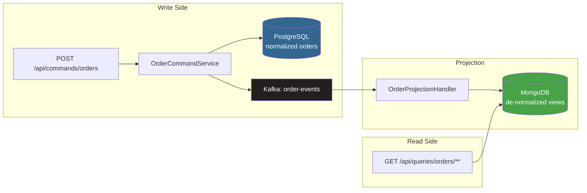

# 03d — CQRS (Command Query Responsibility Segregation)

## What is it?

**CQRS** separates the write model (commands) from the read model (queries). Write side uses normalized Postgres; read side uses a de-normalized MongoDB projection. The two are kept eventually consistent via Kafka events.

## Architecture



## Key Endpoints

| Endpoint | Side | Description |
|----------|------|-------------|
| `POST /api/commands/orders` | Write | Place order → Postgres + Kafka |
| `PUT /api/commands/orders/{id}/confirm` | Write | Confirm order |
| `GET /api/queries/orders` | Read | All orders from MongoDB |
| `GET /api/queries/orders/customer/{id}` | Read | Orders by customer |

## Eventual Consistency

> The read model is **eventually consistent** with the write model. A small delay (milliseconds) exists between a write operation and when it appears in the query results.

```java
// Write side returns 202 Accepted — not 200 OK
return ResponseEntity.accepted().body(order);
```

## Running the Demo

```bash
docker-compose up -d kafka postgres mongo
cd 03-data-management/03d-cqrs
mvn spring-boot:run

# Place an order (write side)
curl -X POST http://localhost:8304/api/commands/orders \
  -H "Content-Type: application/json" \
  -d '{"customerId":"C1","productId":"P1","quantity":2,"unitPrice":49.99}'

# Query (read side — eventually consistent)
curl http://localhost:8304/api/queries/orders
```

## ✅ Pros
- Read and write sides scale independently
- Read model optimized for queries (no joins)
- Natural fit for event-driven systems

## ❌ Cons
- Eventual consistency requires UI adaptation
- Two data stores to manage and monitor
- Higher operational complexity

## When to Use
- High read/write ratio with different access patterns
- Need precomputed, fast dashboard queries
- Already using event sourcing or Kafka

## Configuration, Build, and Run

Production uses PostgreSQL for commands, MongoDB for the projection, and Kafka for events. Tests override the relational store with H2 and use embedded Kafka plus a MongoDB Testcontainer.

```bash
mvn test -pl 03-data-management/03d-cqrs
mvn spring-boot:run -pl 03-data-management/03d-cqrs
```

Use `POST /api/commands/orders`, `PUT /api/commands/orders/{id}/confirm`, and `GET /api/queries/orders`. Health is `/actuator/health`.
