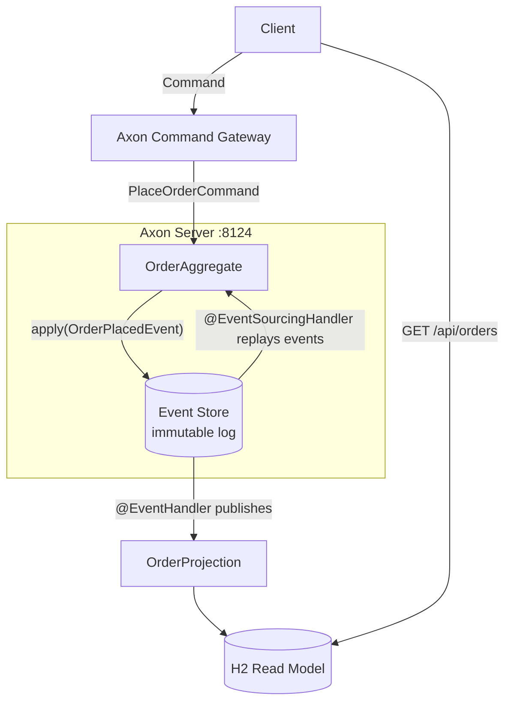

# 03e — Event Sourcing with Axon Framework

## What is it?

**Event Sourcing** stores the full history of state changes as immutable events, not just the current state. The current state is rebuilt by replaying events from the event store.

## Key Insight

```
Traditional DB row:    orderId=1, state=CONFIRMED, total=99.99
Event Store:           [ORDER_PLACED, ORDER_CONFIRMED]     ← replay these to get current state
```

## Architecture



## Event Sourcing vs Traditional

| Aspect | Traditional | Event Sourcing |
|--------|-------------|---------------|
| Storage | Current state only | Full history |
| Audit log | Extra table needed | Automatic |
| Time travel | ❌ Not possible | ✅ Replay to any point |
| Complexity | Simple | High |
| Debug | Hard | Easy — replay events |

## Core Axon Concepts

```java
@Aggregate
public class OrderAggregate {

    @CommandHandler                    // Validates and EMITS events
    public OrderAggregate(PlaceOrderCommand cmd) {
        AggregateLifecycle.apply(new OrderPlacedEvent(...));
    }

    @EventSourcingHandler              // Mutates state when event is applied/replayed
    public void on(OrderPlacedEvent event) {
        this.state = "PENDING";        // ONLY mutation here
    }
}
```

## Running the Demo

```bash
# Axon Server (event store) must be running
docker-compose up -d axon-server

cd 03-data-management/03e-event-sourcing
mvn spring-boot:run

# Place order
curl -X POST http://localhost:8305/api/orders \
  -H "Content-Type: application/json" \
  -d '{"customerId":"C1","productId":"P1","quantity":2,"unitPrice":49.99}'

# View Axon Server event store: http://localhost:8024
```

## ✅ Pros
- Complete audit trail out of the box
- Time-travel debugging (replay to any past state)
- Natural fit for CQRS
- Events are a first-class integration mechanism

## ❌ Cons
- Read latency — must replay events on load (mitigated by snapshots)
- Schema evolution is complex (old events must still be readable)
- Steep learning curve

## When to Use
- Financial systems requiring complete audit trail
- Complex domains with many state transitions
- Need temporal queries (what was the state at time T?)

## Configuration, Build, and Run

Axon Server connection settings and the H2 projection datasource are in `src/main/resources/application.yml`.

```bash
mvn test -pl 03-data-management/03e-event-sourcing
mvn spring-boot:run -pl 03-data-management/03e-event-sourcing
```

Commands are exposed under `/api/orders`; the read projection is available from `GET /api/orders` and `/api/orders/{id}`. Health is `/actuator/health`.
