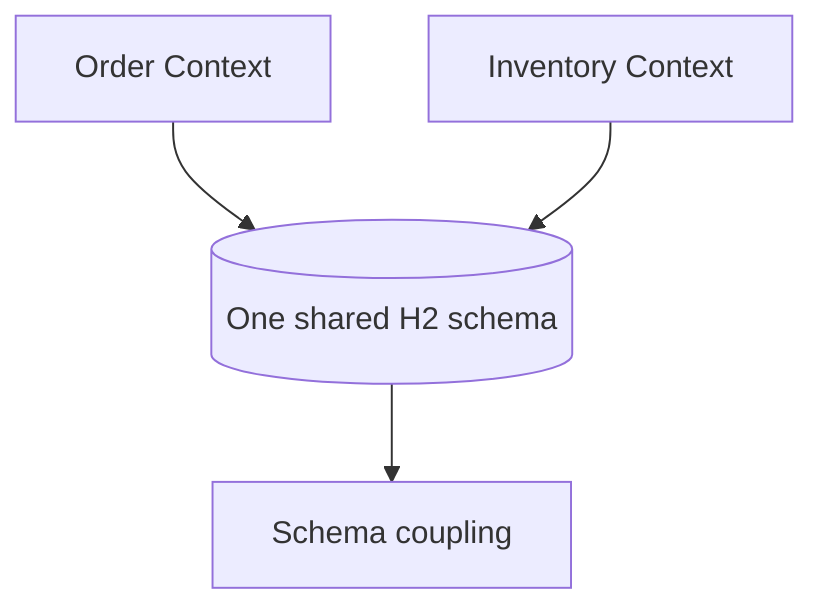

# 03F — Shared Database (anti-pattern)

This module deliberately places order and inventory data behind one shared H2 schema. It makes coupling visible: another bounded context can read the same record, which is convenient but prevents independent schema ownership and deployment.



## Configuration, Build, and Run

Configuration is in `src/main/resources/application.yml`; the H2 console is available at `/h2-console`.

```bash
mvn test -pl 03-data-management/03f-shared-database
mvn spring-boot:run -pl 03-data-management/03f-shared-database
```

Try `POST /api/shared/orders` and `GET /api/shared/orders/{id}`. Health is `/actuator/health`.
