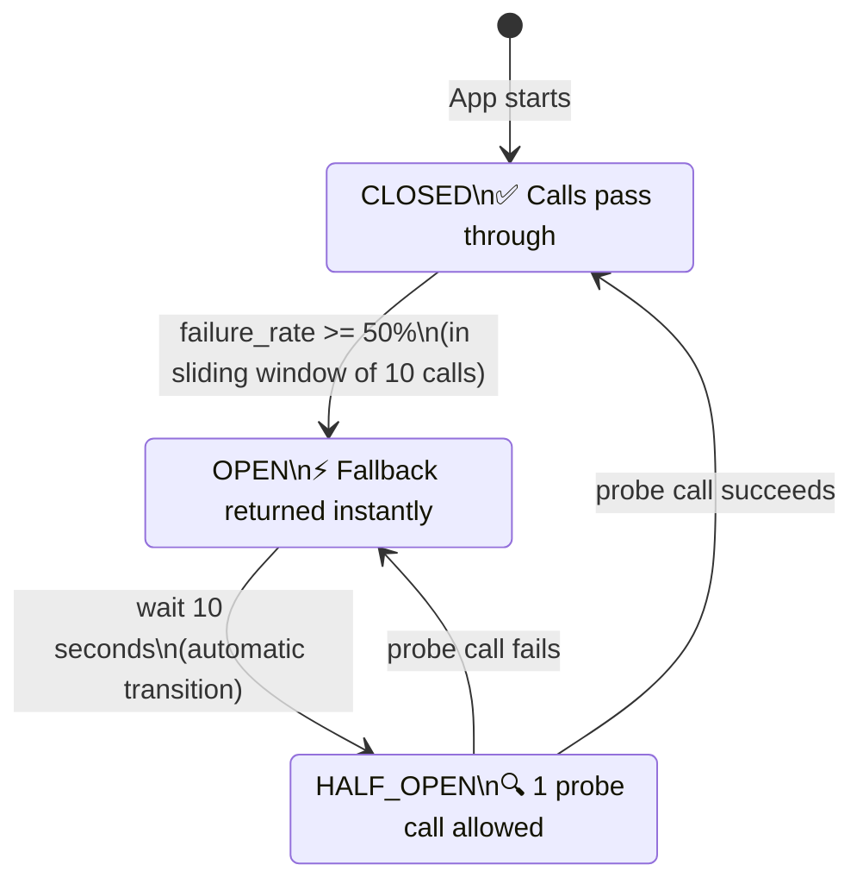
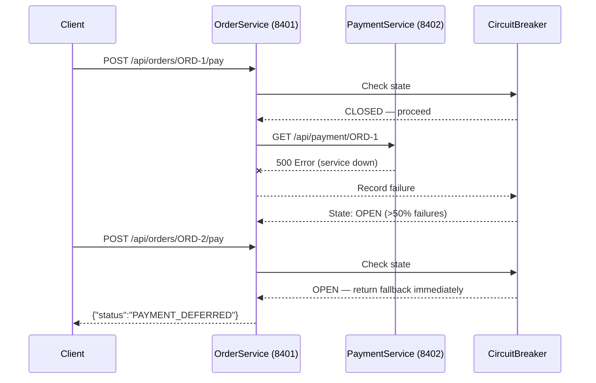

# 04A — Circuit Breaker Pattern

## Overview
Demonstrates the **Circuit Breaker** pattern using **Resilience4j** to protect a service from cascading failures when calling a downstream dependency (Payment Service).

---

## Architecture





---

## Running the Demo

```bash
# 1. Start Order Service (port 8401) WITHOUT Payment Service
cd 04-resilience/04a-circuit-breaker
mvn spring-boot:run

# 2. Call the endpoint repeatedly — watch failures accumulate
for i in {1..6}; do
  curl -X POST "http://localhost:8401/api/orders/ORD-$i/pay?amount=100"
  echo ""
done

# 3. After ~5 failures, circuit OPENS — calls return fallback instantly

# 4. Check circuit breaker status
curl http://localhost:8401/actuator/health | jq .components.circuitBreakers

# 5. Wait 10 seconds, then circuit moves to HALF_OPEN

# 6. Now start the (mock) payment service on 8402 if you have one
# The next probe call succeeds and circuit CLOSES again
```

---

## Configuration (`application.yml`)

```yaml
resilience4j:
  circuitbreaker:
    instances:
      paymentService:
        slidingWindowSize: 10           # Count-based window
        failureRateThreshold: 50        # Open when 50%+ fail
        waitDurationInOpenState: 10s    # Stay open for 10s
        permittedNumberOfCallsInHalfOpenState: 3
        automaticTransitionFromOpenToHalfOpenEnabled: true
```

---

## ✅ Pros

- **Fail fast**: Stops wasting resources on calls that will fail
- **Cascading failure prevention**: Protects the whole system when one service is down
- **Automatic recovery**: Probes the downstream service automatically (HALF_OPEN)
- **Visibility**: Exposes CB state via Spring Boot Actuator metrics
- **Non-invasive**: Added via annotation — no change to business logic

## ❌ Cons

- **Configuration sensitivity**: Wrong `failureRateThreshold` or `waitDuration` causes spurious trips or slow recovery
- **Fallback complexity**: Good fallbacks can be harder to implement than the happy path
- **False positives**: Healthy services can trip the CB during a spike (use `slowCallRateThreshold` carefully)
- **State management**: In multi-instance deployments, CB state is per-instance by default (use Redis-backed CB for shared state)

---

## When to Use

✅ Any synchronous HTTP call to an external or downstream service  
✅ When downstream SLA is unreliable  
✅ Combined with Retry (call Retry first, then CB as outer wrapper)  
❌ Async messaging (use Dead Letter Queues instead)  
❌ Database calls where all latency is expected (use Bulkhead instead)  
