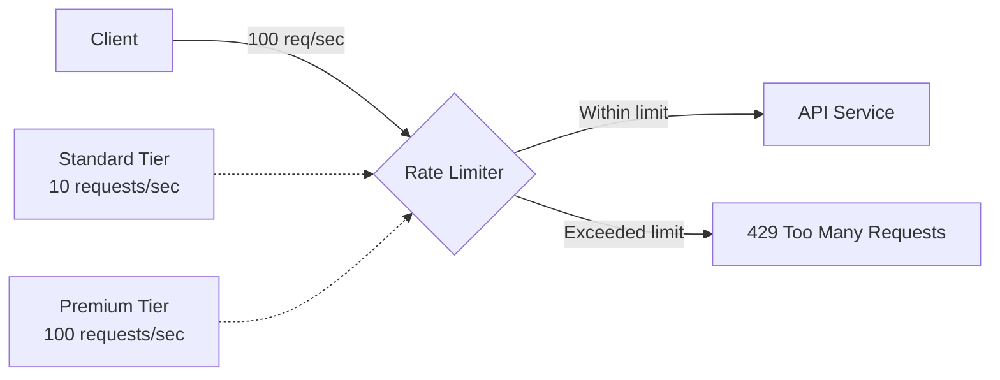

# 04c — Rate Limiter

## What is it?

**Rate Limiting** controls how many requests a service accepts per time window, protecting it from being overwhelmed and ensuring fair resource allocation.

## Token Bucket Algorithm

```
Every 1 second → refill bucket with 10 tokens
Each request → consumes 1 token
Bucket empty → request rejected (429 Too Many Requests)
```

## Architecture



## Configuration

```yaml
resilience4j:
  ratelimiter:
    instances:
      apiRateLimit:
        limit-for-period: 10      # 10 calls per window
        limit-refresh-period: 1s  # Window size: 1 second
        timeout-duration: 0s      # fail-fast, don't queue
```

## Running the Demo

```bash
cd 04-resilience/04c-rate-limiter
mvn spring-boot:run

# Send 15 requests rapidly:
for i in {1..15}; do
  curl -s -o /dev/null -w "%{http_code}\n" http://localhost:8403/api/orders
done
# First 10: 200 OK, next 5: 429 Too Many Requests
```

## ✅ Pros
- Protects service from traffic spikes
- Fair resource allocation between clients
- Tiered access (standard vs premium)

## ❌ Cons
- Clients must implement retry with backoff
- Distributed rate limiting requires Redis (single instance is per-pod)
- Setting limits requires traffic analysis

## When to Use
- Public APIs exposed to the internet
- Free tier / paid tier differentiation
- Internal services at risk of being hammered by batch jobs

## Configuration, Build, and Run

The `publicApi` limiter and Bucket4j settings are in `src/main/resources/application.yml`.

```bash
mvn test -pl 04-resilience/04c-rate-limiter
mvn spring-boot:run -pl 04-resilience/04c-rate-limiter
```

Call `GET /api/limited` repeatedly to observe the configured limit.
