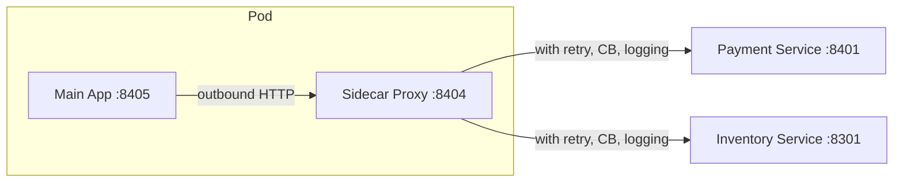

# 04d — Sidecar Pattern

## What is it?

A **Sidecar** is a helper proxy process deployed alongside each application pod that handles cross-cutting concerns (retries, circuit breaking, logging, mTLS) without the app knowing.

## Architecture



## Sidecar vs Hardcoded Resilience

| Aspect | Hardcoded in App | Sidecar |
|--------|-----------------|---------|
| Language coupling | ✅ Library in same language | ❌ Independent process |
| Config change | Redeploy app | Update sidecar config |
| Cross-cutting | Each app implements separately | Shared pattern |
| Real world | Resilience4j in code | Envoy / Istio |

## Running the Demo

```bash
cd 04-resilience/04d-sidecar
mvn spring-boot:run

# The sidecar runs on :8404 and proxies to upstream services
# All outbound requests from your main app go through localhost:8404
```

## ✅ Pros
- Handles resilience, security, observability without app code changes
- Consistent behavior for all languages/frameworks
- Config changes don't require app redeployment

## ❌ Cons
- Extra network hop (app → sidecar → upstream)
- More complex resource profiling
- Debugging distributed traces becomes harder

## Real World
Envoy Proxy (used by Istio) is the industry-standard sidecar implementation. This module simulates its behavior in pure Spring Boot.

## Configuration, Build, and Run

Proxy policy and upstream settings are in `src/main/resources/application.yml`.

```bash
mvn test -pl 04-resilience/04d-sidecar
mvn spring-boot:run -pl 04-resilience/04d-sidecar
```

Call `GET /api/sidecar/policy`; health is `/actuator/health`.
