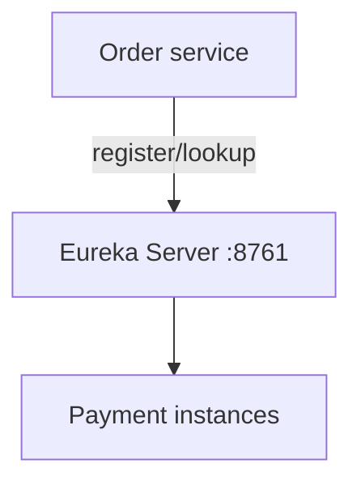

# 05A — Service registry and discovery

Netflix Eureka is the registry. Services register their instance metadata and clients resolve logical names instead of hard-coded host/port pairs.



## Configuration, Build, and Run

Settings are in `src/main/resources/application.yml`; this module disables self-registration.

```bash
mvn test -pl 05-discovery-config/05a-service-registry
mvn spring-boot:run -pl 05-discovery-config/05a-service-registry
```

The Eureka dashboard is `/` and health is `/actuator/health`.
