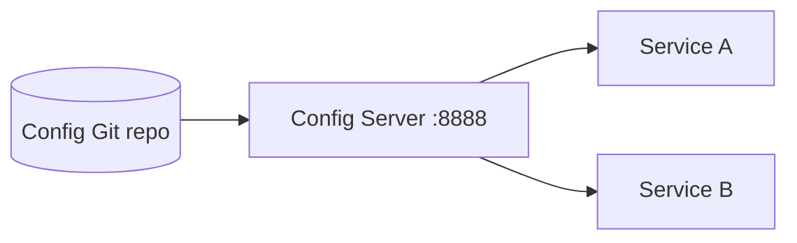

# 05B — Centralized configuration

Spring Cloud Config Server reads versioned configuration from Git and serves environment-specific properties to clients.



## Configuration, Build, and Run

The local Git URI is configured in `src/main/resources/application.yml`; set `spring.cloud.config.server.git.uri` for a real repository.

```bash
mvn test -pl 05-discovery-config/05b-centralized-config
mvn spring-boot:run -pl 05-discovery-config/05b-centralized-config
```

Use `/api/config/info` for the demo policy and `/actuator/health` for health.
