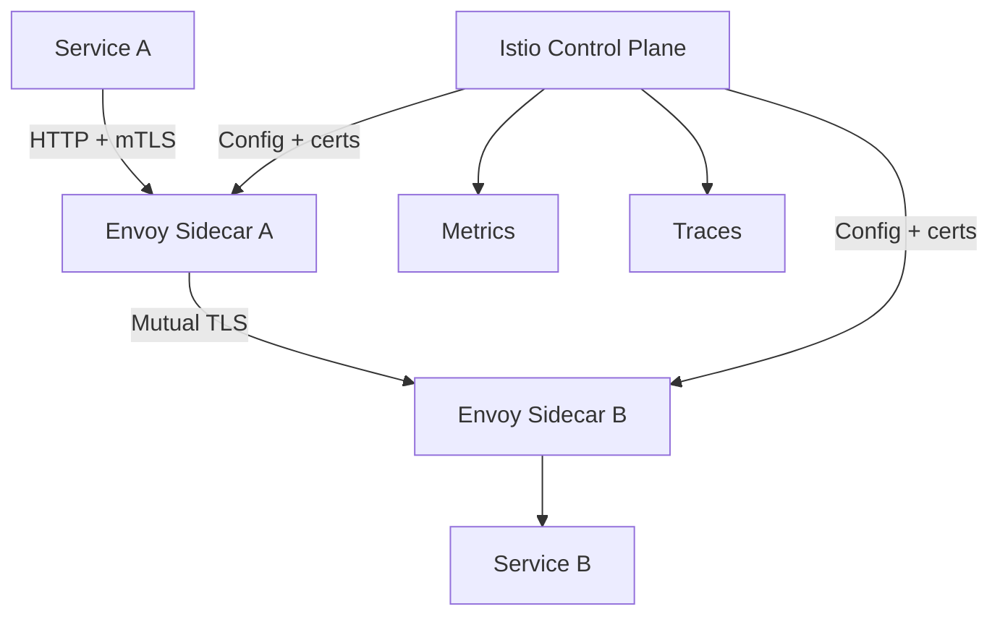

# 05c — Service Mesh Concept

## What is it?

A **Service Mesh** is an infrastructure layer that transparently handles service-to-service communication, including retry, circuit breaking, load balancing, mTLS, and observability — without application code changes.

## Architecture



## Service Mesh vs API Gateway

| Feature | API Gateway | Service Mesh |
|---------|------------|-------------|
| Scope | North/South (external traffic) | East/West (internal traffic) |
| mTLS | ❌ | ✅ Automatic |
| Per-service policy | ❌ Complex | ✅ Native |
| Observability | Partial | ✅ Full tracing |

## This Module Demonstrates

This module simulates a service mesh in pure Spring Boot — with Resilience4j for retry/CB and Eureka for discovery. In production, this would be Istio/Linkerd deploying Envoy sidecars.

## When to Use Real Istio/Linkerd

## Configuration, Build, and Run

Mesh policy and Eureka settings are in `src/main/resources/application.yml`.

```bash
mvn test -pl 05-discovery-config/05c-service-mesh
mvn spring-boot:run -pl 05-discovery-config/05c-service-mesh
```

Call `GET /api/mesh/policy`; health is `/actuator/health`.
- Your cluster has 20+ services
- Need automatic mTLS between all services
- Mixed language services (Java + Go + Python)
- Need traffic management (A/B testing, canary) without code

## Running the Demo

```bash
docker-compose up -d
cd 05-discovery-config/05c-service-mesh
mvn spring-boot:run
```
