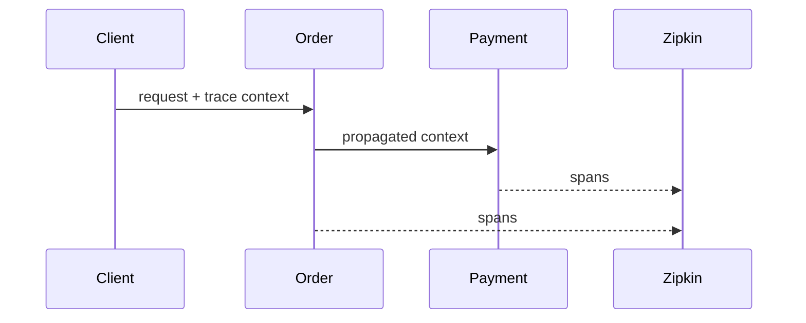

# 06A — Distributed tracing

Micrometer Tracing instruments request boundaries and propagates trace/span context across service calls. Zipkin receives sampled spans.



## Configuration, Build, and Run

Sampling and Zipkin endpoint settings are in `src/main/resources/application.yml`.

```bash
mvn test -pl 06-observability/06a-distributed-tracing
mvn spring-boot:run -pl 06-observability/06a-distributed-tracing
```

Call `GET /api/tracing/checkout`; view traces at `http://localhost:9411`.
