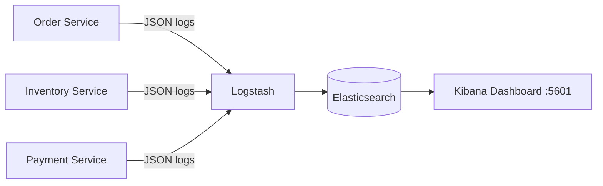

# 06b — Log Aggregation (ELK Stack)

## What is it?

**Log Aggregation** collects and centralizes logs from all microservices into a single searchable store (Elasticsearch), providing correlation via trace IDs.

## Architecture



## Structured JSON Logging

All services log in JSON format for Logstash parsing:

```json
{
  "timestamp": "2024-01-01T12:00:00.000Z",
  "level": "INFO",
  "service": "log-aggregation-demo",
  "traceId": "abc123",
  "spanId": "def456",
  "logger": "com.micarch.logging",
  "message": "Order placed successfully"
}
```

## Trace Correlation

Each request carries a `traceId` that propagates through all services. In Kibana, filter by `traceId` to see the complete request journey across services:

```
Kibana query: traceId: "abc123"
→ Shows all log entries from all services for this single request
```

## Running the Demo

```bash
# Start ELK stack
docker-compose up -d elasticsearch logstash kibana

# Start the service
cd 06-observability/06b-log-aggregation
mvn spring-boot:run

# Kibana: http://localhost:5601
# Create index pattern: logstash-* 
# Filter: service:"log-aggregation-demo"
```

## ✅ Pros
- Centralized search across all services
- Trace ID correlation across services
- Alerting on error patterns
- Long-term log retention with ILM

## ❌ Cons
- Elasticsearch is resource-intensive
- Log volume can be enormous at scale
- Requires log format standardization

## When to Use

## Configuration, Build, and Run

Structured console logging is configured in `src/main/resources/application.yml`.

```bash
mvn test -pl 06-observability/06b-log-aggregation
mvn spring-boot:run -pl 06-observability/06b-log-aggregation
```

Call `GET /api/logs/sample`; health is `/actuator/health`.
- More than 3 services in production
- Need to debug issues that span multiple services
- Compliance requiring log retention
