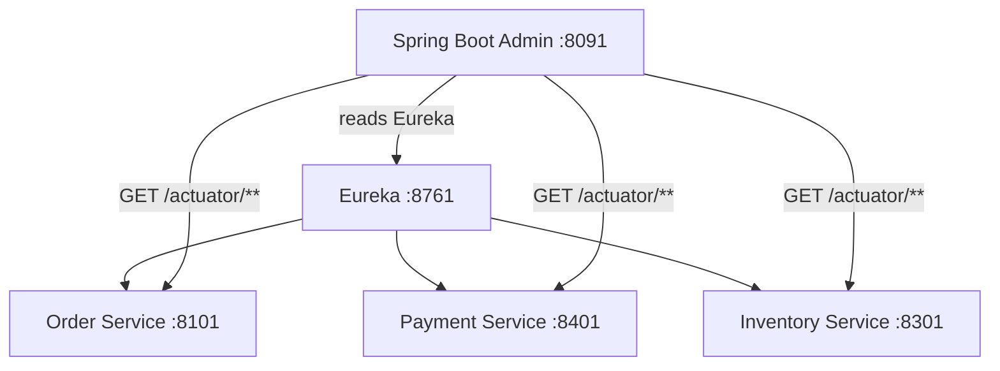

# 06c — Health Check Aggregation (Spring Boot Admin)

## What is it?

**Spring Boot Admin** is a dashboard that aggregates health checks from all registered microservices, showing their status, logs, metrics, and environment in one UI.

## Architecture



## What You Can See in the Dashboard

| Feature | URL |
|---------|-----|
| Service health | /health |
| Application info | /info |
| JVM metrics | /metrics |
| Loggers (change level at runtime!) | /loggers |
| Environment variables | /env |
| Heap dumps | /heapdump |
| Thread dumps | /threaddump |

## Running the Demo

```bash
# Start Eureka first
cd 05-discovery-config/05a-service-registry
mvn spring-boot:run

# Start Admin Server
cd 06-observability/06c-health-check-aggregation
mvn spring-boot:run

# Admin UI: http://localhost:8091
# All Eureka-registered services appear automatically
```

## ✅ Pros
- Zero config for new services (auto-discovery via Eureka)
- Runtime log level changes without restart
- Health history and downtime tracking

## ❌ Cons
- Exposes sensitive actuator endpoints — must secure with Spring Security
- Not suitable as a production monitoring replacement (use Prometheus + Grafana)

## When to Use
- Dev/Test environments for quick service overview
- When Grafana/Datadog is not yet set up
- Need to change log levels in production without redeployment
