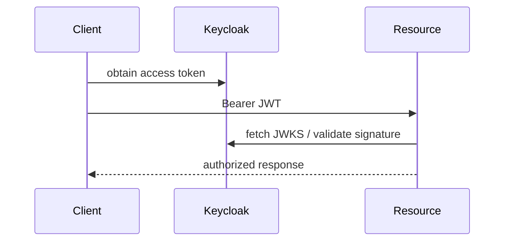

# 07A — OAuth2 resource server with JWT

The service validates bearer JWTs issued by Keycloak. Authentication is stateless; authorization decisions use scopes/roles from claims.



## Configuration, Build, and Run

Issuer and JWKS settings are in `src/main/resources/application.yml`; start the repository Keycloak container first.

```bash
mvn test -pl 07-security/07a-oauth2-jwt
mvn spring-boot:run -pl 07-security/07a-oauth2-jwt
```

Protected demo endpoint: `GET /api/profile`. Health is `/actuator/health`.
