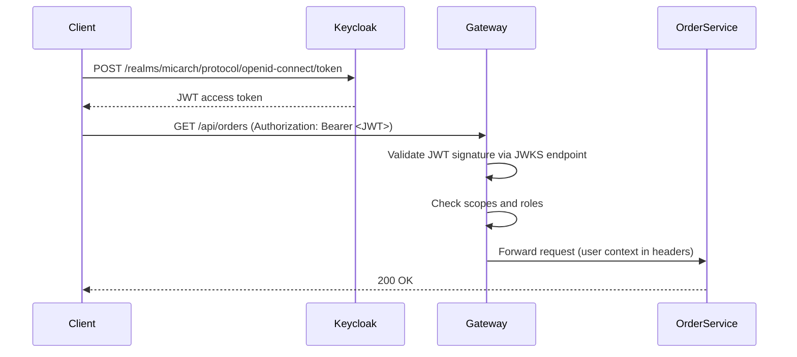

# 07b — API Gateway Security with Keycloak JWT

## What is it?

Demonstrates securing a **Spring Cloud Gateway** with Keycloak JWT validation. The gateway acts as the entry point — no JWT validation happens inside downstream services; only at the gateway.

## Architecture



## Route-Level Authorization

```yaml
spring.cloud.gateway.routes:
  - id: order-service
    uri: http://localhost:8101
    predicates: [Path=/api/orders/**]
    filters:
      - TokenRelay=    # Forwards JWT token to downstream service
```

## Getting a Token

```bash
# Get access token from Keycloak
curl -X POST http://localhost:8180/realms/micarch/protocol/openid-connect/token \
  -d "grant_type=password&client_id=micarch-gateway&client_secret=micarch-gateway-secret" \
  -d "username=testuser&password=password"

# Use token to call a protected route
curl http://localhost:8702/api/orders \
  -H "Authorization: Bearer <ACCESS_TOKEN>"
```

## Running the Demo

```bash
docker-compose up -d keycloak
cd 07-security/07b-api-gateway-security
mvn spring-boot:run

# Swagger (with OAuth2 login): http://localhost:8702/swagger-ui.html
```

## ✅ Pros
- Centralized auth — downstream services don't validate tokens
- Role-based route protection per route
- TokenRelay propagates user context seamlessly

## ❌ Cons
- Gateway is a critical single point of trust
- Rogue internal service can bypass gateway
- Token relay means downstream services don't verify signatures (trust gateway)

## When to Use
- Public API with OAuth2 external users
- Need role-based API routing at the edge
- Keycloak already in the stack
