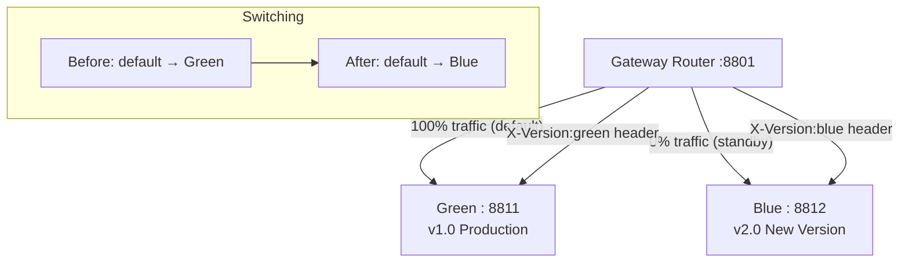

# 08a — Blue-Green Deployment

## What is it?

**Blue-Green** runs two identical production environments. One receives all traffic (Green = active), the other is idle (Blue = standby). You deploy to Blue, test it, then switch traffic instantly.

## Architecture



## Deployment Workflow

| Step | Action |
|------|--------|
| 1 | Deploy v2.0 to Blue (idle) |
| 2 | Route test traffic via `X-Version: blue` header |
| 3 | Run smoke tests against Blue |
| 4 | Switch default route from Green to Blue |
| 5 | Monitor Blue for errors |
| 6 | Rollback: switch default back to Green (instant!) |

## Running the Demo

```bash
cd 08-deployment/08a-blue-green
mvn spring-boot:run

# Test Blue version (before switching)
curl http://localhost:8801/api/orders -H "X-Version: blue"

# Switch to Blue (edit application.yml, restart)
# Or call actuator to refresh routes
curl -X POST http://localhost:8801/actuator/gateway/refresh
```

## ✅ Pros
- Zero-downtime deployments
- Instant rollback (switch back to old version)
- Ability to test new version before fully switching

## ❌ Cons
- Requires 2x infrastructure cost during deployment window
- Database migrations must be backward-compatible (old + new code run simultaneously)
- Stateful services (sessions) need sticky routing during transition

## When to Use

## Configuration, Build, and Run

Active/standby route URIs are in `src/main/resources/application.yml`.

```bash
mvn test -pl 08-deployment/08a-blue-green
mvn spring-boot:run -pl 08-deployment/08a-blue-green
```

Call `GET /deployment/state`; switch the default route URI to roll back or promote.
- Zero-downtime requirement for critical services
- High-risk deployments needing instant rollback capability
