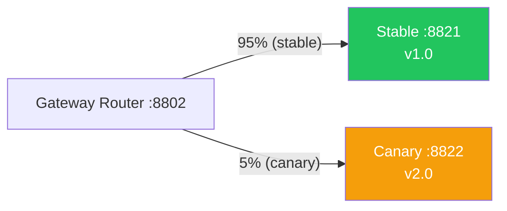

# 08b — Canary Release

## What is it?

**Canary release** gradually shifts traffic from the stable version to the new version. If error rates are acceptable, traffic is progressively increased until 100% of users are on the new version.

## Traffic Split Architecture



## Progressive Rollout Steps

| Stage | Stable | Canary | Action |
|-------|--------|--------|--------|
| Initial | 100% | 0% | Deploy canary (idle) |
| Phase 1 | 95% | 5% | Monitor error rate |
| Phase 2 | 80% | 20% | If error rate < 5% |
| Phase 3 | 50% | 50% | Half-half split |
| Final | 0% | 100% | Promote canary to stable |
| Rollback | 100% | 0% | If error rate ≥ 5% |

## Gateway Weight Config

```yaml
spring.cloud.gateway.routes:
  - id: stable
    uri: http://localhost:8821
    predicates: [Path=/api/**, "Weight=canary-group, 95"]   # 95%
  - id: canary
    uri: http://localhost:8822
    predicates: [Path=/api/**, "Weight=canary-group, 5"]    # 5%
```

## Running the Demo

```bash
cd 08-deployment/08b-canary
mvn spring-boot:run

# Prometheus metrics: http://localhost:8802/actuator/prometheus
# Adjust weights: edit application.yml and actuator/gateway/refresh
```

## ✅ Pros
- Real user testing with limited blast radius
- Automatic rollback based on error metrics
- Gradual confidence building

## ❌ Cons
- Longer deployment window (hours vs seconds for blue-green)
- Two versions running simultaneously (DB must support both schemas)
- Requires good metrics infrastructure for auto-rollback

## When to Use
- Releasing features that need real-user validation
- Low confidence in new version's correctness
- A/B testing new features
