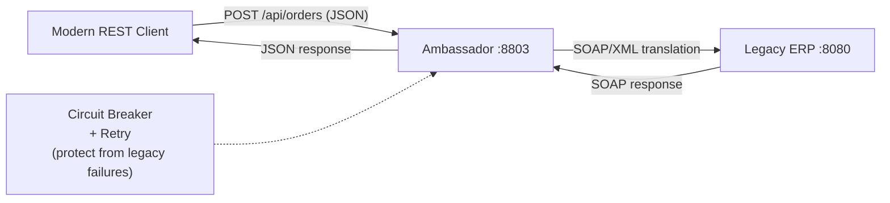

# 08c — Ambassador Pattern

## What is it?

An **Ambassador** is a proxy service placed in front of a legacy or external system, translating modern REST calls into legacy protocols (SOAP/XML, gRPC, proprietary binary).

## Architecture



## What the Ambassador Does

| Concern | Handled By Ambassador |
|---------|-----------------------|
| Protocol translation | REST → SOAP/XML |
| Field mapping | `orderId` → `orderNumber` (legacy naming) |
| Circuit breaking | Protects from legacy outages |
| Retry with backoff | Handles intermittent legacy errors |
| Header transformation | Adds SOAP action headers |
| Response caching | Caches slow legacy responses |

## Running the Demo

```bash
cd 08-deployment/08c-ambassador
mvn spring-boot:run

# Place order (JSON → auto-translated to SOAP for legacy)
curl -X POST http://localhost:8803/api/orders \
  -H "Content-Type: application/json" \
  -d '{"customerId":"C1","productId":"P100","quantity":5}'

# Swagger: http://localhost:8803/swagger-ui.html
```

## ✅ Pros
- Legacy system untouched
- Modern clients don't know about legacy complexity
- Resilience layer protects modern apps from legacy instability

## ❌ Cons
- Additional network hop
- Must maintain protocol translation as legacy changes
- Risk of becoming a "leaky abstraction"

## When to Use
- Integrating with legacy ERP/SOAP systems
- Third-party APIs that aren't REST-friendly
- Need to add resilience to unmodifiable external systems
