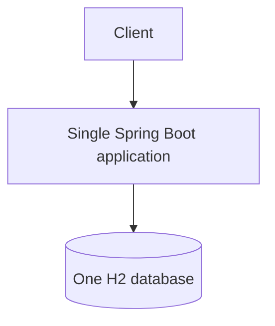

# 09A — Monolith starter

This is the baseline application: order, inventory, user, and payment capabilities live in one deployable process and one H2 database.



## Configuration, Build, and Run

H2 and actuator settings are in `src/main/resources/application.yml`.

```bash
mvn test -pl 09-legacy-patterns/09a-monolith-starter
mvn spring-boot:run -pl 09-legacy-patterns/09a-monolith-starter
```

Try `POST/GET /api/monolith/orders/{id}`; health is `/actuator/health`.
