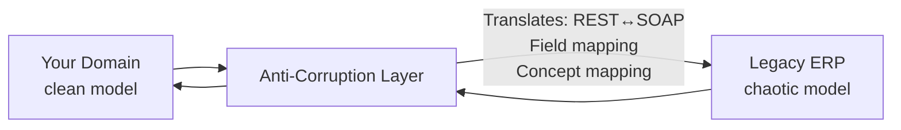

# 09b — Anti-Corruption Layer (ACL)

## What is it?

The **Anti-Corruption Layer** is a translation layer that shields your bounded context from the messy or poorly modeled concepts in a legacy system or external domain.

## Architecture



## Concept Translation Example

| Your Domain | Legacy ERP | Meaning |
|-------------|------------|---------|
| `orderId` | `orderNumber` | Same thing, different naming |
| `customerId` | `clientCode` | Customer identifier |
| `quantity` | `unitCount` | Item quantity |
| `productId` | `itemRef` | Product reference |
| `PENDING` | `WAITING_APPROVAL` | Order state |

## ACL Translation Code

```java
// Translator: converts legacy LegacyOrder → your clean domain Order
@Component
public class LegacyOrderTranslator {

    public Order toDomain(LegacyOrder legacy) {
        return Order.builder()
            .orderId(legacy.getOrderNumber())   // Field name mapping
            .customerId(legacy.getClientCode())
            .quantity(legacy.getUnitCount())
            .status(mapStatus(legacy.getStatus())) // Concept mapping
            .build();
    }

    private OrderStatus mapStatus(String legacyStatus) {
        return switch (legacyStatus) {
            case "WAITING_APPROVAL" -> OrderStatus.PENDING;
            case "DISPATCHED"       -> OrderStatus.SHIPPED;
            default                 -> OrderStatus.UNKNOWN;
        };
    }
}
```

## Running the Demo

```bash
cd 09-legacy-patterns/09b-anti-corruption-layer
mvn spring-boot:run
# Swagger: http://localhost:9002/swagger-ui.html
```

## ✅ Pros
- Protects your clean domain from "legacy model pollution"
- Legacy changes only require translator updates, not domain changes
- Enables partial migration with both systems running

## ❌ Cons
- Extra development and maintenance of translator
- Potential performance overhead of translation
- Can become complex if legacy model is very different

## When to Use

## Configuration, Build, and Run

Legacy endpoint and field mappings are in `src/main/resources/application.yml`.

```bash
mvn test -pl 09-legacy-patterns/09b-anti-corruption-layer
mvn spring-boot:run -pl 09-legacy-patterns/09b-anti-corruption-layer
```

Use `POST /api/acl/translate`; health is `/actuator/health`.
- Integrating with any external system whose model doesn't fit your domain
- Migrating from a monolith to microservices incrementally
- Working with third-party APIs with different conventions
