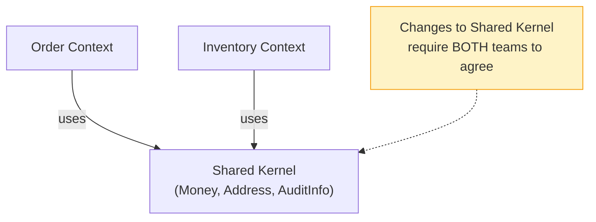

# 09c — Shared Kernel

## What is it?

A **Shared Kernel** is a small subset of the domain model explicitly shared between two or more bounded contexts with an agreement to keep it in sync.

## Architecture



## What Goes in a Shared Kernel

Only **stable, generic concepts** that are truly common across contexts:

| Class | Why Share It |
|-------|-------------|
| `Money` | Currency + amount — universal concept |
| `Address` | Standardized postal address format |
| `AuditInfo` | Created/updated timestamps, user |
| `PhoneNumber` | Validated phone with country code |

## What Does NOT Go in a Shared Kernel

❌ Domain-specific aggregates (Order, Inventory)  
❌ Business rules (pricing logic, discount calculations)  
❌ Service interfaces  
❌ Anything that changes frequently

## Running the Demo

```bash
cd 09-legacy-patterns/09c-shared-kernel
mvn spring-boot:run

# Swagger: http://localhost:9003/swagger-ui.html
# H2 Console: http://localhost:9003/h2-console
```

## ✅ Pros
- Avoids DRY violations for genuinely common concepts
- Consistent language across teams
- Reduces integration points for utility types

## ❌ Cons
- Both teams must coordinate every change
- Risk of scope creep (teams add too much to the kernel)
- Creates coupling between otherwise independent contexts

## When to Use
- 2-3 teams sharing stable utility types like Money or Address
- Small enough shared content that coordination is manageable
- Not as an alternative to designing proper bounded contexts

> 💡 **If your shared kernel is growing** — split the offending concepts out into their own context or publish them as a shared library instead.
