# 🏗️ Microservices Mastery: Production-Grade Spring Boot Learning Project

**Root Directory:** `d:/ijws/AllRepos/micarch`

This curriculum covers **every** major microservices pattern — both legacy and modern — as individual, runnable Spring Boot applications organized inside a Maven multi-module parent project. Each module demonstrates a pattern end-to-end with production-quality code, a `README.md`, and a Mermaid architecture diagram.

---

## Project Topology

```
micarch/                                    ← Parent Maven POM (BOM + dependency management)
├── pom.xml                                 ← Aggregator POM
├── 01-decomposition/
│   ├── 01a-domain-driven-decomposition/    ← DDD Bounded Contexts
│   ├── 01b-strangler-fig/                  ← Legacy migration pattern
│   └── 01c-bulkhead/                       ← Isolation & fault containment
├── 02-communication/
│   ├── 02a-api-gateway/                    ← Spring Cloud Gateway
│   ├── 02b-backend-for-frontend/           ← BFF pattern
│   ├── 02c-synchronous-rest/               ← REST + OpenFeign
│   ├── 02d-async-messaging/                ← Kafka event bus
│   └── 02e-grpc-service/                   ← gRPC communication
├── 03-data-management/
│   ├── 03a-database-per-service/           ← Polyglot persistence
│   ├── 03b-saga-choreography/              ← Event-driven sagas
│   ├── 03c-saga-orchestration/             ← Orchestrated sagas
│   ├── 03d-cqrs/                           ← Command Query Responsibility Segregation
│   ├── 03e-event-sourcing/                 ← Axon Framework event store
│   └── 03f-shared-database/               ← Legacy anti-pattern demo
├── 04-resilience/
│   ├── 04a-circuit-breaker/                ← Resilience4j CB
│   ├── 04b-retry-timeout/                  ← Retry + timeout policies
│   ├── 04c-rate-limiter/                   ← Bucket4j / Resilience4j RL
│   └── 04d-sidecar/                        ← Envoy sidecar simulation
├── 05-discovery-config/
│   ├── 05a-service-registry/               ← Eureka server + clients
│   ├── 05b-centralized-config/             ← Spring Cloud Config Server
│   └── 05c-service-mesh/                   ← Istio concept simulation
├── 06-observability/
│   ├── 06a-distributed-tracing/            ← Micrometer Tracing + Zipkin
│   ├── 06b-log-aggregation/                ← ELK stack integration
│   └── 06c-health-check-aggregation/       ← Spring Boot Actuator + Eureka health
├── 07-security/
│   ├── 07a-oauth2-jwt/                     ← Keycloak OAuth2 + JWT
│   └── 07b-api-gateway-security/           ← Gateway-level auth enforcement
├── 08-deployment/
│   ├── 08a-blue-green/                     ← Blue-green deployment simulation
│   ├── 08b-canary/                         ← Canary release with weighted routing
│   └── 08c-ambassador/                     ← Ambassador pattern
└── 09-legacy-patterns/
    ├── 09a-monolith-starter/               ← Starting point monolith
    ├── 09b-anti-corruption-layer/          ← ACL between legacy & new
    └── 09c-shared-kernel/                  ← Shared library anti-pattern demo
```

---

## Technology Stack

| Layer | Technology |
|---|---|
| Framework | Spring Boot 3.3.x |
| Build | Maven 3.9+ (multi-module) |
| Service Discovery | Netflix Eureka (Spring Cloud) |
| Config | Spring Cloud Config Server |
| Gateway | Spring Cloud Gateway |
| Messaging | Apache Kafka |
| Resilience | Resilience4j v2, Bucket4j |
| Tracing | Micrometer Tracing + Zipkin |
| Security | Spring Security + Keycloak |
| Persistence | H2 (dev), PostgreSQL, MongoDB |
| Event Sourcing | Axon Framework |
| RPC | gRPC + protobuf |
| Containerization | Docker + Docker Compose |
| Docs | SpringDoc OpenAPI 3 |

---

## Pattern Catalog

---

### GROUP 1 — Decomposition Patterns

---

#### 1A. Domain-Driven Decomposition (Bounded Contexts)

> **Goal:** Decompose a monolith by aligning service boundaries to DDD Bounded Contexts.

**Example:** An e-commerce app split into `order-service`, `inventory-service`, and `payment-service` — each owning its own domain model.

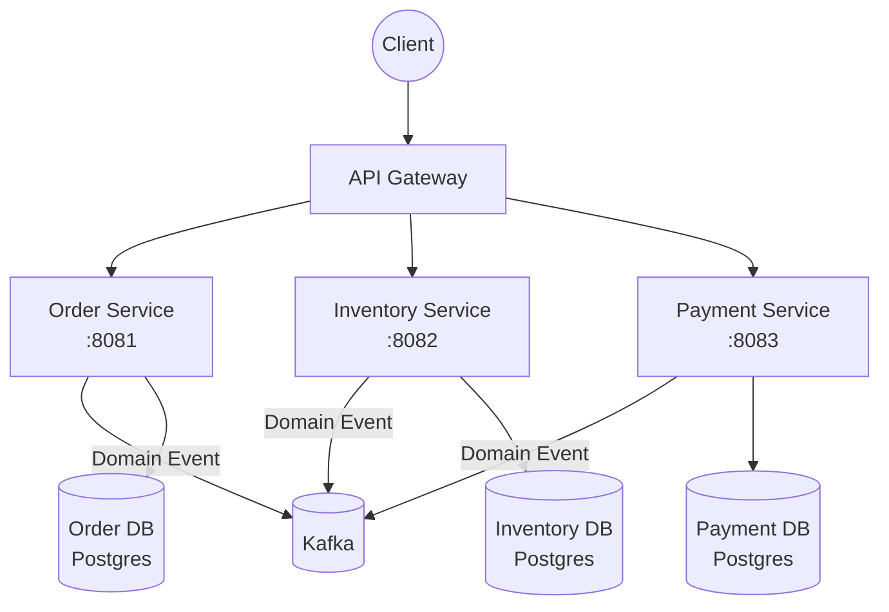

| ✅ Pros | ❌ Cons |
|---|---|
| Services align to business capability | Requires deep domain knowledge upfront |
| Teams can own and deploy independently | Cross-domain operations need sagas/events |
| Natural scalability per bounded context | Risk of chatty inter-service calls |

---

#### 1B. Strangler Fig Pattern

> **Goal:** Incrementally migrate a monolith to microservices by routing traffic gradually.

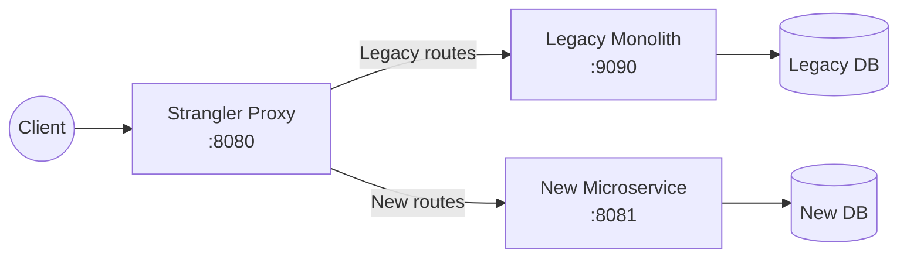

| ✅ Pros | ❌ Cons |
|---|---|
| Zero big-bang rewrite risk | Proxy adds complexity |
| Allows incremental migration | Dual maintenance during migration |
| Easy rollback to monolith | Requires feature-flag discipline |

---

#### 1C. Bulkhead Pattern

> **Goal:** Isolate failures so one overloaded service doesn't cascade and bring everything down.

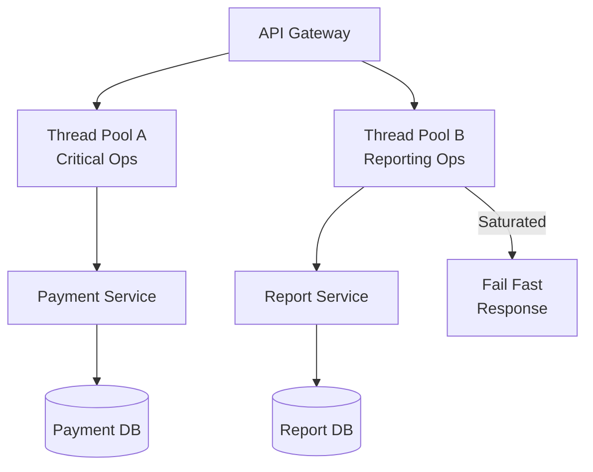

| ✅ Pros | ❌ Cons |
|---|---|
| Isolates failures to a partition | Added configuration complexity |
| Protects critical paths | Thread pool tuning is non-trivial |
| Improves overall system resilience | Resource overhead per pool |

---

### GROUP 2 — Communication Patterns

---

#### 2A. API Gateway

> **Goal:** Single entry point for all clients providing routing, auth, rate limiting, and protocol translation.

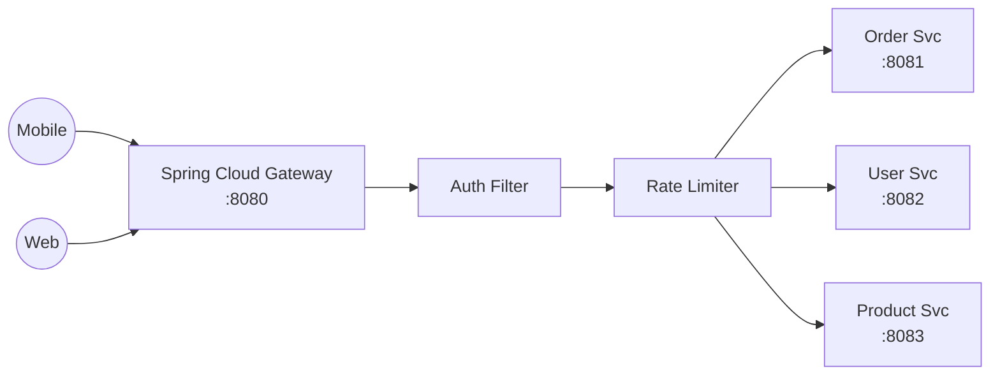

| ✅ Pros | ❌ Cons |
|---|---|
| Cross-cutting concerns centralised | Single point of failure if not HA |
| Client insulated from topology changes | Can become a development bottleneck |
| SSL termination, auth, compression | Risk of "mega-gateway" anti-pattern |

---

#### 2B. Backend for Frontend (BFF)

> **Goal:** Dedicated gateway tailored per client type (mobile, web, IoT).

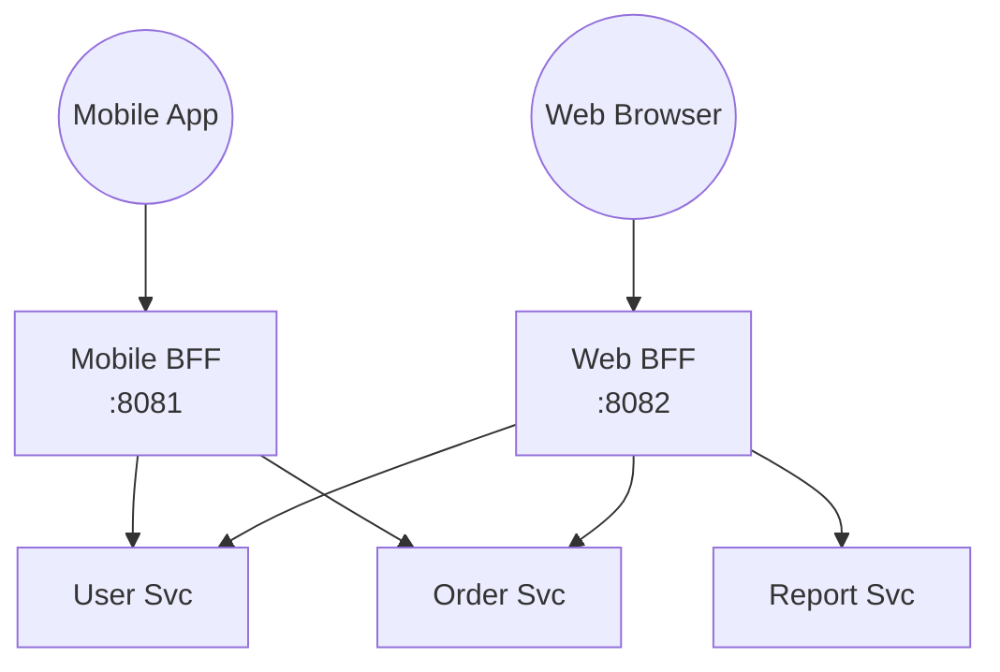

| ✅ Pros | ❌ Cons |
|---|---|
| Optimised payload per client type | Code duplication across BFFs |
| Faster mobile performance | More services to maintain |
| Clear client-team ownership | Risk of divergent data contracts |

---

#### 2C. Synchronous REST (OpenFeign)

> **Goal:** Direct service-to-service HTTP calls using declarative Feign clients with load balancing.

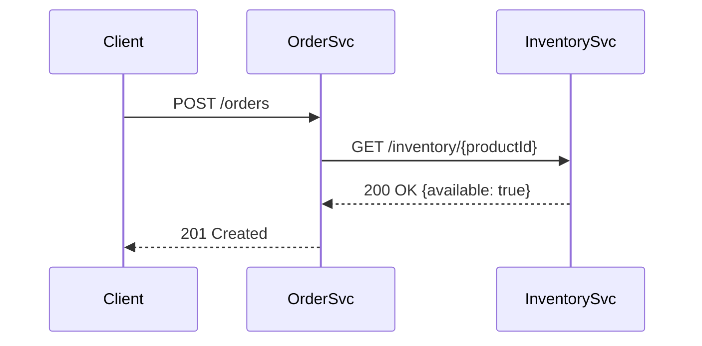

| ✅ Pros | ❌ Cons |
|---|---|
| Simple, intuitive request/response | Temporal coupling between services |
| Easy to debug with HTTP tools | Cascading failures without circuit breakers |
| Standard OpenAPI contracts | Synchronous latency chain |

---

#### 2D. Asynchronous Messaging (Kafka)

> **Goal:** Event-driven communication where producers and consumers are fully decoupled.

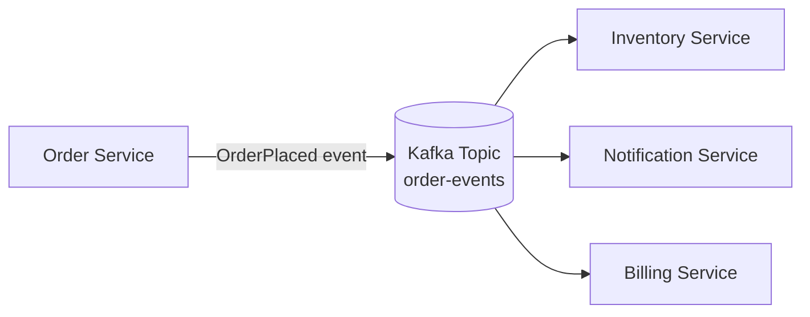

| ✅ Pros | ❌ Cons |
|---|---|
| Temporal decoupling — no chatty calls | Eventual consistency is harder to reason about |
| Natural backpressure via consumer groups | Debugging event flows is complex |
| Scales independently per consumer | Message ordering needs care |

---

#### 2E. gRPC Service Communication

> **Goal:** High-throughput binary RPC between services using Protocol Buffers.

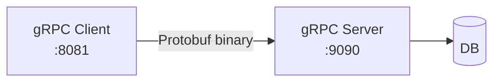

| ✅ Pros | ❌ Cons |
|---|---|
| Extremely fast, compact binary payload | Harder to debug than REST |
| Strong schema via `.proto` contracts | Limited browser support (needs gRPC-Web) |
| Bi-directional streaming | Learning curve for proto IDL |

---

### GROUP 3 — Data Management Patterns

---

#### 3A. Database per Service

> **Goal:** Each microservice owns its own datastore; no shared schema.

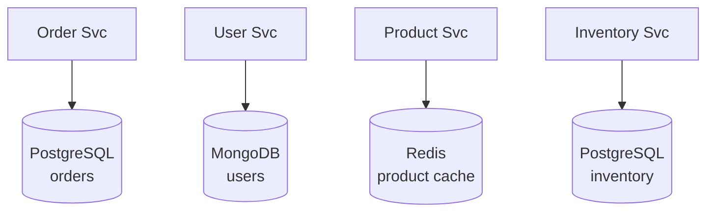

| ✅ Pros | ❌ Cons |
|---|---|
| Independent schema evolution | Cross-service joins become API calls or events |
| Polyglot — use best DB for each service | Distributed transactions complexity |
| No schema coupling | Data duplication across services |

---

#### 3B. Saga — Choreography

> **Goal:** Distributed transactions managed via reactive event chains (no central orchestrator).

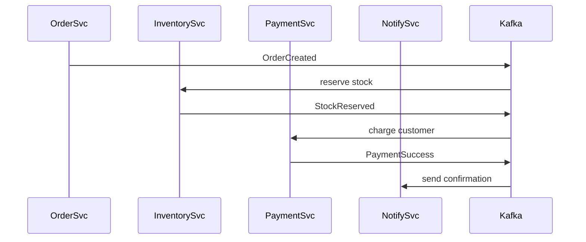

| ✅ Pros | ❌ Cons |
|---|---|
| Fully decoupled services | Hard to track overall saga state |
| No single point of orchestration failure | Cyclic dependencies are risky |
| Natural event-driven fit | Compensating transactions are complex |

---

#### 3C. Saga — Orchestration

> **Goal:** Central Saga Orchestrator drives the transaction steps, telling services what to do.

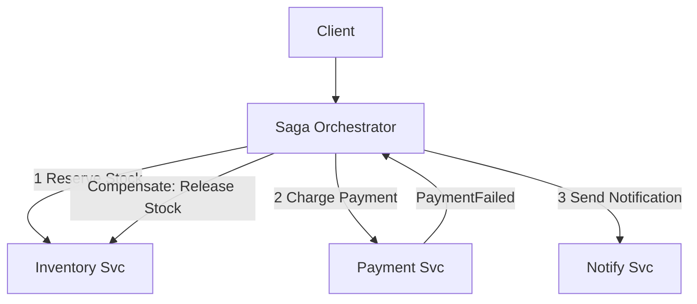

| ✅ Pros | ❌ Cons |
|---|---|
| Central visibility into saga progress | Orchestrator can become a bottleneck |
| Easier to implement compensations | Orchestrator is a coupled dependency |
| Clear failure handling logic | More code in the orchestrator |

---

#### 3D. CQRS (Command Query Responsibility Segregation)

> **Goal:** Separate the write model (commands) from the read model (queries) for scalability and clarity.

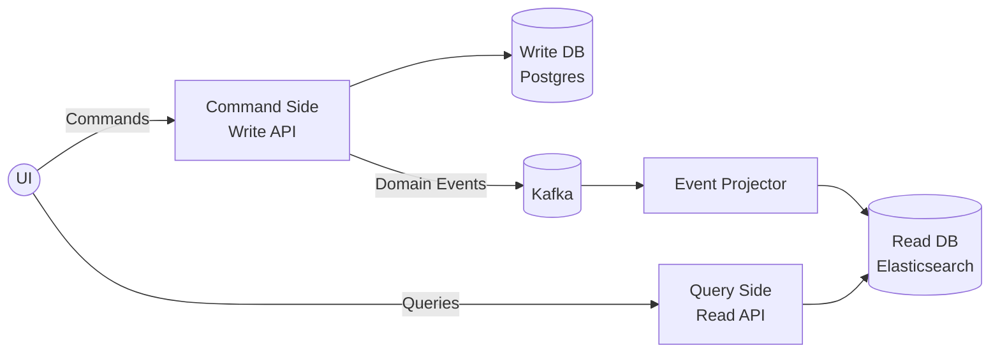

| ✅ Pros | ❌ Cons |
|---|---|
| Read/write models optimised independently | Eventual consistency between write and read |
| Scales reads separately from writes | Significant additional complexity |
| Clean separation of concerns | More infrastructure (projectors, read stores) |

---

#### 3E. Event Sourcing (Axon Framework)

> **Goal:** Persist the full history of domain events rather than the current state snapshot.

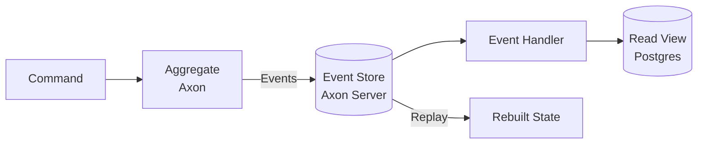

| ✅ Pros | ❌ Cons |
|---|---|
| Full audit trail and time-travel | Query complexity — always reconstruct state |
| Enables CQRS read projections | Event schema evolution is hard |
| Replay events to rebuild state | Event store grows indefinitely |

---

#### 3F. Shared Database (Legacy Anti-Pattern)

> **Goal:** Demonstrate why sharing a single DB schema across services is problematic.

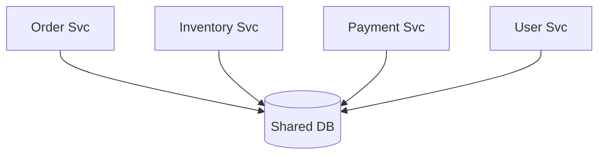

| ✅ Pros | ❌ Cons |
|---|---|
| Simple joins across data | Tight coupling — schema change breaks all services |
| Easy transactionality | Cannot scale services independently |
| Familiar for monolith devs | One service can corrupt another's data |

---

### GROUP 4 — Resilience Patterns

---

#### 4A. Circuit Breaker (Resilience4j)

> **Goal:** Automatically stop calling a failing service and fail fast.

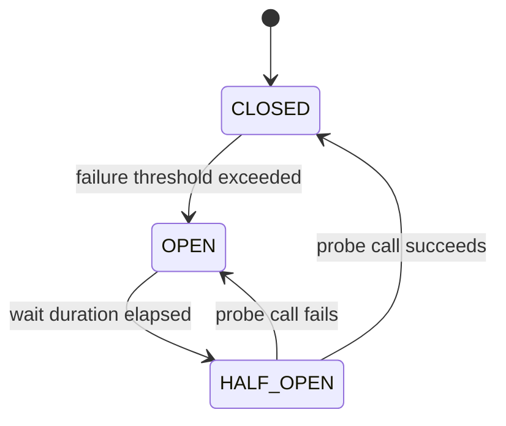

| ✅ Pros | ❌ Cons |
|---|---|
| Prevents cascade failures | State management complexity |
| Fail-fast instead of timeout wait | Threshold tuning can be tricky |
| Allows system to self-heal | False positives can block healthy services |

---

#### 4B. Retry + Timeout

> **Goal:** Transparently retry transient failures with exponential backoff and enforce call timeouts.

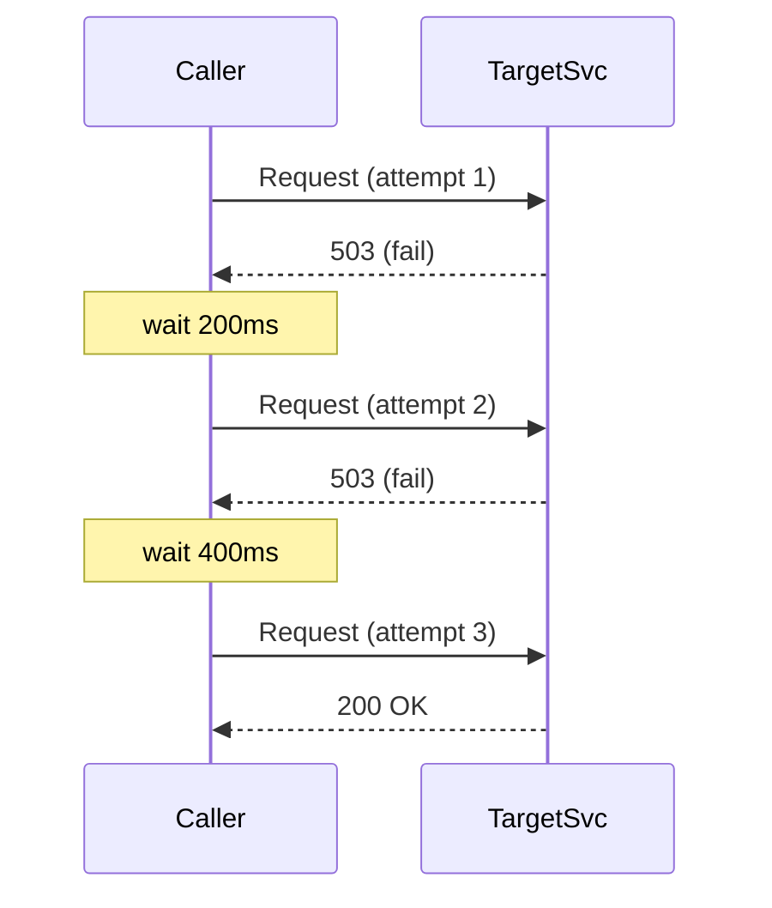

| ✅ Pros | ❌ Cons |
|---|---|
| Handles transient network issues automatically | Retry storms can amplify load |
| Exponential backoff reduces thundering herd | Non-idempotent ops must not retry blindly |
| Simple to configure with Resilience4j | Adds latency on retried paths |

---

#### 4C. Rate Limiter

> **Goal:** Protect services from being overwhelmed by too many requests.

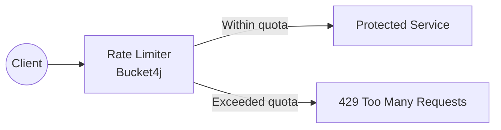

| ✅ Pros | ❌ Cons |
|---|---|
| Prevents DoS and resource exhaustion | Legitimate traffic can be rejected |
| Fair resource allocation between clients | Distributed rate limiting needs shared store |
| SLA enforcement | Token bucket vs sliding window tradeoffs |

---

#### 4D. Sidecar Pattern

> **Goal:** Offload cross-cutting concerns (TLS, tracing, retries) to a sidecar proxy running alongside each service.

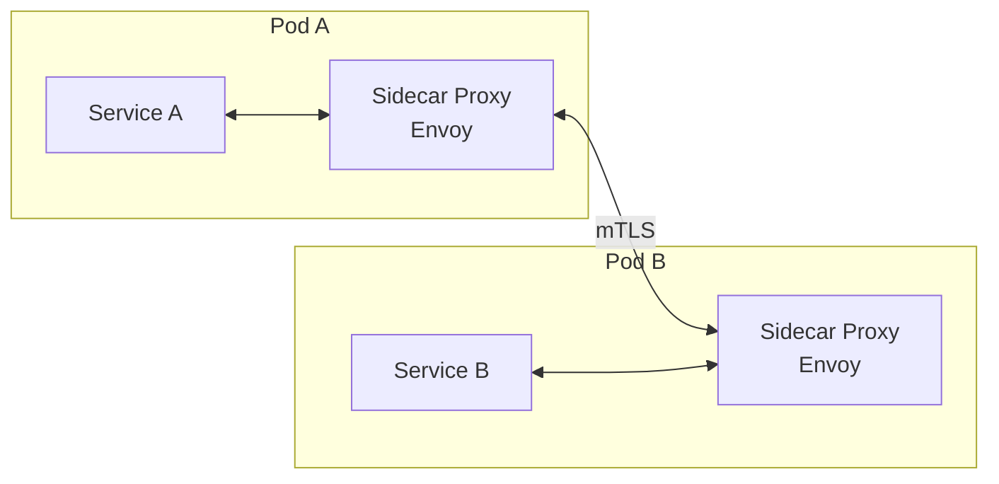

| ✅ Pros | ❌ Cons |
|---|---|
| Language-agnostic cross-cutting concerns | Running extra process per service pod |
| Service code stays clean | Adds network hop latency |
| Consistent policy enforcement | Operational complexity of sidecar fleet |

---

### GROUP 5 — Discovery & Configuration Patterns

---

#### 5A. Service Registry & Discovery (Eureka)

> **Goal:** Services register themselves; clients discover each other without hardcoded URLs.

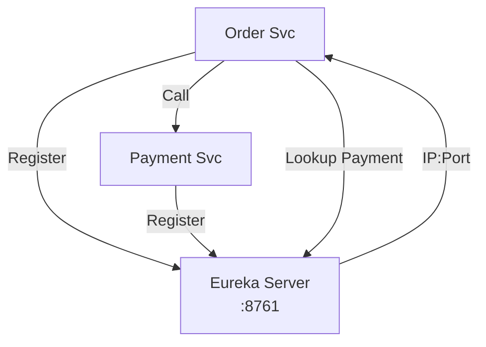

| ✅ Pros | ❌ Cons |
|---|---|
| No hardcoded service addresses | Eureka is eventually consistent |
| Enables dynamic scaling | Stale registry entries during crash |
| Load balancing via client-side ribbon/LB | Another service to operate |

---

#### 5B. Centralized Configuration (Spring Cloud Config)

> **Goal:** Externalize all configuration into a single Git-backed config server.

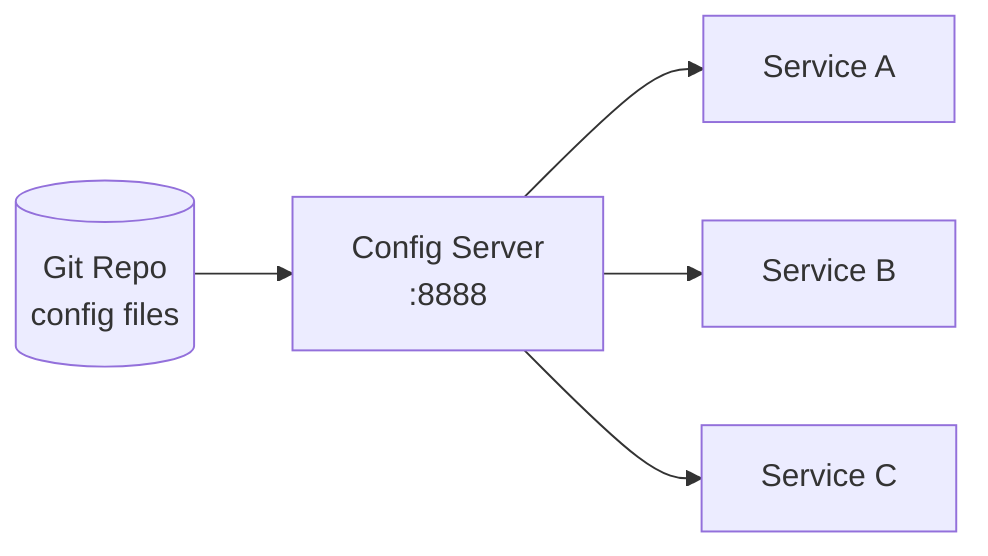

| ✅ Pros | ❌ Cons |
|---|---|
| Config changes without redeployment | Config server is a critical dependency |
| Git history for config auditing | Bootstrap latency on startup |
| Environment-specific overrides | Secrets management needs Vault integration |

---

#### 5C. Service Mesh (Concept Simulation)

> **Goal:** Demonstrate how a mesh (Istio/Linkerd) handles all communication policy: mTLS, retries, canary.

```mermaid
graph TD
    ControlPlane[Istio Control Plane\nPilot / Citadel / Galley]
    ControlPlane -->|Config push| SideA[Envoy - Svc A]
    ControlPlane -->|Config push| SideB[Envoy - Svc B]
    SideA <-->|mTLS, tracing, retries| SideB
```

| ✅ Pros | ❌ Cons |
|---|---|
| Uniform security, observability, traffic policy | Very high operational complexity |
| Service code is completely clean | Not suitable for small-scale deployments |
| A/B testing, canary routing built-in | Steep Kubernetes dependency |

---

### GROUP 6 — Observability Patterns

---

#### 6A. Distributed Tracing (Micrometer + Zipkin)

> **Goal:** Trace a request as it flows through multiple services using correlation IDs.

```mermaid
graph LR
    Client --> GW[Gateway]
    GW -->|TraceId propagated| OrderSvc[Order Svc]
    OrderSvc -->|TraceId propagated| PaySvc[Payment Svc]
    PaySvc -->|TraceId propagated| NotifySvc[Notify Svc]
    OrderSvc & PaySvc & NotifySvc --> Zipkin[Zipkin\n:9411]
```

| ✅ Pros | ❌ Cons |
|---|---|
| End-to-end request visibility across services | Overhead of span collection |
| Root cause analysis across service boundaries | Sampling means not all traces captured |
| Latency profiling per service hop | Instrumentation discipline required |

---

#### 6B. Log Aggregation (ELK)

> **Goal:** Centralize logs from all services into Elasticsearch + Kibana for search and dashboards.

```mermaid
graph LR
    SvcA[Service A] -->|Logback JSON| Logstash[Logstash]
    SvcB[Service B] -->|Logback JSON| Logstash
    SvcC[Service C] -->|Logback JSON| Logstash
    Logstash --> ES[(Elasticsearch)]
    ES --> Kibana[Kibana\nDashboard]
```

| ✅ Pros | ❌ Cons |
|---|---|
| Single pane of glass for all service logs | ELK stack is resource-intensive |
| Full-text search and log correlation | Log shipping adds I/O overhead |
| Alerting on log patterns | Structured logging discipline required |

---

#### 6C. Health Check Aggregation

> **Goal:** Expose and aggregate health of all services through Spring Boot Actuator + custom dashboard.

```mermaid
graph TD
    Admin[Spring Boot Admin\n:9090] -->|polls /actuator/health| SvcA[Service A]
    Admin -->|polls /actuator/health| SvcB[Service B]
    Admin -->|polls /actuator/health| SvcC[Service C]
    Admin --> Dash[Health Dashboard]
```

| ✅ Pros | ❌ Cons |
|---|---|
| Instant visibility into service health | Polling introduces tail latency |
| Custom health indicators per service | False positives on transient probes |
| Integrates with Kubernetes liveness probes | Dashboard is another service to run |

---

### GROUP 7 — Security Patterns

---

#### 7A. OAuth2 + JWT (Keycloak)

> **Goal:** Centralized identity provider issues JWTs for stateless auth across all services.

```mermaid
sequenceDiagram
    participant Client
    participant Keycloak
    participant Gateway
    participant Svc
    Client->>Keycloak: POST /token (credentials)
    Keycloak-->>Client: JWT access_token
    Client->>Gateway: Request + Bearer JWT
    Gateway->>Gateway: Validate JWT signature
    Gateway->>Svc: Forward with claims
    Svc-->>Client: 200 OK
```

| ✅ Pros | ❌ Cons |
|---|---|
| Stateless — no session affinity needed | JWT cannot be revoked before expiry |
| Single identity source for all services | Key rotation needs careful rolling |
| Standard OAuth2 scopes for authorization | Token size can be large |

---

#### 7B. API Gateway Security

> **Goal:** Enforce authentication, authorization, and input validation at the gateway before requests reach services.

```mermaid
graph LR
    Client --> GW[Spring Cloud Gateway]
    GW --> AuthFilter[Auth Filter\nJWT Validation]
    AuthFilter --> RoleFilter[Role Check Filter]
    RoleFilter --> RateLimit[Rate Limit Filter]
    RateLimit --> Svc[Protected Microservice]
    AuthFilter -->|Invalid| Reject[401 Unauthorized]
    RoleFilter -->|Forbidden| Reject2[403 Forbidden]
```

| ✅ Pros | ❌ Cons |
|---|---|
| Security concern centralised | Gateway becomes critical bottleneck |
| Services don't need to validate tokens | Gateway must stay in sync with auth policy |
| Easier audit trail | Bypassing gateway reaches unprotected services |

---

### GROUP 8 — Deployment Patterns

---

#### 8A. Blue-Green Deployment

> **Goal:** Run two identical environments; switch traffic instantly with zero downtime.

```mermaid
graph LR
    LB[Load Balancer] -->|100% traffic| Blue[Blue Env v1.0\n:8081]
    LB -->|0% traffic| Green[Green Env v1.1\n:8082]
    Note1[Deploy v1.1 to Green]
    Note2[Switch LB → Green]
    Note1 --> Note2
```

| ✅ Pros | ❌ Cons |
|---|---|
| Zero-downtime deployments | Doubles infrastructure cost |
| Instant rollback by flipping LB | DB schema migration requires care |
| Easy smoke testing on idle environment | Stateful services are complex to switch |

---

#### 8B. Canary Release

> **Goal:** Route a small percentage of traffic to a new version before full rollout.

```mermaid
graph LR
    LB[Load Balancer] -->|95% traffic| Stable[Stable v1.0]
    LB -->|5% traffic| Canary[Canary v1.1]
    Canary --> Monitor[Monitor Errors/Latency]
    Monitor -->|Healthy| Promote[Promote to 100%]
    Monitor -->|Unhealthy| Rollback[Rollback Canary]
```

| ✅ Pros | ❌ Cons |
|---|---|
| Real production validation with limited blast radius | Requires sophisticated traffic routing |
| Gradual confidence building | Metrics comparison can be noisy |
| Easy rollback if metrics degrade | Running two versions adds complexity |

---

#### 8C. Ambassador Pattern

> **Goal:** A helper service (ambassador) acts as a proxy between a service and external systems, handling retries, circuit breaking, and logging.

```mermaid
graph LR
    AppSvc[App Service] --> Ambassador[Ambassador Proxy\nSidecar]
    Ambassador -->|Handles retries, CB, logging| Ext[External API / Legacy System]
```

| ✅ Pros | ❌ Cons |
|---|---|
| Legacy/external API logic isolated from app | Extra network hop |
| Reusable across multiple app services | Yet another process to manage |
| Centralizes connectivity concerns | Versioning between ambassador and app |

---

### GROUP 9 — Legacy / Anti-Patterns (Educational)

---

#### 9A. Monolith Starter

> **Goal:** Baseline monolithic Spring Boot app that the rest of the curriculum migrates away from.

```mermaid
graph TD
    Client --> Monolith[Monolith App\n:8080]
    Monolith --> DB[(Single DB)]
```

| ✅ Pros | ❌ Cons |
|---|---|
| Simple development & deployment | All-or-nothing scaling |
| Easy transactions and joins | One team owns everything |
| Fast in early stages | Release cycle bottleneck |

---

#### 9B. Anti-Corruption Layer (ACL)

> **Goal:** Translates between the model of a new microservice and a legacy system's model.

```mermaid
graph LR
    NewSvc[New Microservice] --> ACL[Anti-Corruption Layer\nTranslator]
    ACL --> LegacyAPI[Legacy System / SOAP API]
```

| ✅ Pros | ❌ Cons |
|---|---|
| Protects new domain model from legacy pollution | ACL code must track both models |
| Enables incremental migration | Adds latency per translation |
| Keeps domain model clean | Dev effort to build and maintain |

---

#### 9C. Shared Kernel

> **Goal:** Demonstrate a shared library used by multiple services — and when it becomes a liability.

```mermaid
graph TD
    SharedLib[Shared Kernel\ncommon-lib.jar] --> SvcA[Service A]
    SharedLib --> SvcB[Service B]
    SharedLib --> SvcC[Service C]
```

| ✅ Pros | ❌ Cons |
|---|---|
| DRY — reuse common domain types | Version coordination across all services |
| Avoid duplicating value objects | Changing shared code breaks many services |
| Single truth for shared contracts | Tight coupling via the shared lib |

---

## Proposed Changes

### Root Project

#### [NEW] [pom.xml](file:///d:/ijws/AllRepos/micarch/pom.xml)
Parent Maven aggregator POM with Spring Boot BOM, Java 21, and all child modules declared.

#### [NEW] [docker-compose.yml](file:///d:/ijws/AllRepos/micarch/docker-compose.yml)
Orchestrates Kafka, Zookeeper, Zipkin, PostgreSQL, MongoDB, Redis, Keycloak, Axon Server, Elasticsearch, Kibana, and Logstash.

#### [NEW] [README.md](file:///d:/ijws/AllRepos/micarch/README.md)
Top-level README with pattern catalog navigation.

---

### One Spring Boot Module per Pattern

Each module follows an identical structure:
```
{module}/
├── pom.xml
├── src/main/java/com/micarch/{pattern}/
│   ├── config/          ← Spring configuration
│   ├── controller/      ← REST / gRPC endpoint
│   ├── service/         ← Business logic
│   ├── domain/          ← Domain model / events
│   ├── repository/      ← Data access
│   └── Application.java ← Spring Boot entry point
├── src/main/resources/
│   ├── application.yml
│   └── bootstrap.yml
├── src/test/             ← Integration tests
└── README.md             ← Pattern explanation + Mermaid diagram
```

Total modules: **19 Spring Boot applications + 1 parent POM**

---

## Verification Plan

### Automated Tests
Each module contains integration tests runnable with:
```bash
# From root
mvn clean test -pl {module-name}

# All modules
mvn clean test
```

### Module Build Verification
```bash
# From d:/ijws/AllRepos/micarch
mvn clean package -DskipTests
```

### Infrastructure Startup
```bash
# From d:/ijws/AllRepos/micarch
docker-compose up -d
```

### Manual Verification
For each module:
1. Start the module: `mvn spring-boot:run -pl {module-name}`
2. Open `http://localhost:{port}/swagger-ui.html` to test endpoints via OpenAPI UI
3. Check `http://localhost:{port}/actuator/health` returns `{"status":"UP"}`
